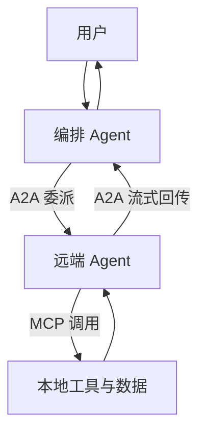

## 一句话定位

A2A 与 MCP 是**互补而非替代**的关系，它们解决的是 Agent 生态中两个**不同方向**的问题：**MCP 是纵向的（应用 ↔ 工具与数据），A2A 是横向的（Agent ↔ Agent）**。

**MCP 让 Agent 拥有"工具"，A2A 让 Agent 拥有"同事"。** MCP 关心的是"**我能调用什么**"，A2A 关心的是"**我能把什么事托付给谁**"。

## MCP 与 A2A 的本质区别

### 抽象对象不同

| 维度 | MCP | A2A |
|------|-----|-----|
| 抽象对象 | **能力原语**（Tools / Resources / Prompts） | **Task / Message / Artifact** |
| 对象性质 | 被动的、无状态的、被调用的一方 | 有生命周期、有状态、会中途反问、可以拒绝的**主动主体** |
| 隐含需求 | 无 | 必须定义状态机、流式更新、多轮消息与拒绝语义 |

### 连接方向不同

| 维度 | MCP | A2A |
|------|-----|-----|
| 心智模型 | 函数调用 | 任务委托 |
| 连接方向 | **应用主动去连工具**（Client 拉取工具列表、发起调用） | **把活派给对方，然后跟进**（委派、订阅状态、回收产物） |

## 两者如何组合使用

### 同一个 Agent 上同时存在

典型的生产架构里，**每个 Agent 同时扮演两个角色**：作为 **MCP Client** 使用本地工具与数据（数据库、代码沙箱、搜索），作为 **A2A Server** 对外暴露自己的专业能力。**一个 Agent 既是"客户"也是"供应商"**。

### 组合起来的完整链路

**MCP 在内、A2A 在外。** 完整链路为：用户 → 编排 Agent（读多个 Agent Card 做匹配）→ 通过 **A2A** 把专业子任务委托给远端 Agent → 远端 Agent 内部通过 **MCP** 调用自己的工具与数据 → 远端通过 A2A 流式回传状态与产物 → 编排 Agent 汇总交付。

## 认证模型与能力发现的差异

### 认证模型不同

| 维度 | MCP | A2A |
|------|-----|-----|
| 授权对象 | **面向资源**（能不能访问这个工具/这个资源） | **面向主体**（对方是谁、能不能把这件事托付给它、可信度如何） |
| 额外需求 | 无 | **身份联邦、信任等级、跨组织授权** |

### 能力发现的粒度不同

| 维度 | MCP | A2A |
|------|-----|-----|
| 发现机制 | `tools/list` 发现**细粒度工具** | Agent Card 发现**粗粒度能力** |
| 编排位置 | 通常在**执行期**被调用 | 通常在**规划期**被选择 |

## 成熟度与生态

MCP 已成为事实标准，生态工具丰富；A2A 规范较新，主要价值体现在**跨组织、跨厂商的长程协作**。

:::note
**在单组织内部，直接用代码框架编排多 Agent，往往比引入 A2A 更简单可控** —— 因为 A2A 带来的网络开销、鉴权复杂度与调试难度都是真实的成本。
:::

## 不要混淆的三个边界

:::caution[三个边界]
**① A2A 不是 MCP 的替代** —— 它们在不同层，用途不冲突。

**② A2A 不是多 Agent 框架** —— 框架（如 AutoGen、CrewAI）是**进程内的编排库**，A2A 是**跨进程的协作协议**，两者可组合使用。

**③ Function Calling 也不是 MCP 的替代** —— 那是模型接口层的机制，是 MCP 内部实现 LLM 侧推理的基础。
:::

## 选型建议

:::tip[选型建议]
| 场景 | 选择 | 理由 |
|------|------|------|
| 内部多 Agent 编排 | **框架** | 进程内，简单可控 |
| 生态工具接入 | **MCP** | 写一次到处用 |
| 跨组织/跨厂商协作 | **A2A** | 能力发现 + 任务委托 + 异步跟进 |

**三者可以同时出现在一个系统里。**
:::
