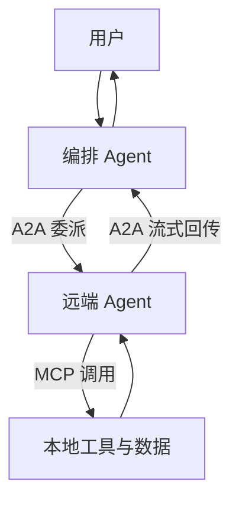

A2A 与 MCP 是**互补而非替代**的关系，它们解决的是 Agent 生态中两个**不同方向**的问题：**MCP 是纵向的，管「应用 ↔ 工具与数据」；A2A 是横向的，管「Agent ↔ Agent」**。落到一句话上，**MCP 让 Agent 拥有「工具」，A2A 让 Agent 拥有「同事」**——MCP 关心「我能调用什么」，A2A 关心「我能把什么事托付给谁」。所以两者不是同一层的两个版本，而是同一条链路里的内外两层。

## 为什么是互补：纵向够得着世界，横向找得到人

MCP 解决的是「Agent 怎么够得着外部世界」：它把外部系统抽象成一组能力原语（**Tools / Resources / Prompts**），由本地应用作为 Client 主动去连、主动去调，调完把结果回填。

A2A 解决的是「Agent 怎么和另一个 Agent 打交道」：对面不是一个函数，而是一个**有自己一摊事要做的独立主体**，它可以中途反问、可以声明拒绝、可以异步推进很久。

这两件事互相顶不上。只有 MCP，Agent 能调工具却没法把一段专业任务整体交给别的 Agent；只有 A2A，Agent 能四处喊人帮忙，自己却仍然碰不到数据库、代码沙箱和搜索。所以它们是分层关系：**MCP 在内，A2A 在外**。

## 抽象对象不同：能力原语 vs 任务

| 维度 | MCP | A2A |
| --- | --- | --- |
| 抽象对象 | **能力原语**（Tools / Resources / Prompts） | **Task / Message / Artifact** |
| 对象性质 | 被动的、无状态的、被调用的一方 | 有生命周期、有状态、会中途反问、可以拒绝的**主动主体** |
| 隐含需求 | 无 | 必须定义状态机、流式更新、多轮消息与拒绝语义 |

差别不在词汇，在「对方是不是活的」。一次 MCP 工具调用失败就是失败，重试即可；一个 A2A 的 Task 可能跑很久，中途还可能回一句「我需要你补一个参数」，最后交付一个 Artifact。状态机不是为了好看才存在的，是因为对端主体会中途变卦。

## 连接方向不同：函数调用 vs 任务委托

| 维度 | MCP | A2A |
| --- | --- | --- |
| 心智模型 | 函数调用 | 任务委托 |
| 连接方向 | **应用主动去连工具**（Client 拉取工具列表、发起调用） | **把活派给对方，然后跟进**（委派、订阅状态、回收产物） |

用类比最省事：调用 MCP 工具像「**调用自己程序里的一个函数**」，参数进去、结果出来、同步拿回；使用 A2A 像「**把一件事托付给另一个部门的同事，然后跟进他做到哪一步**」，中间要问进度、要等、可能被反问、最后拿回一份成果，而不是一个返回值。

## 认证模型与能力发现的差异

| 维度 | MCP | A2A |
| --- | --- | --- |
| 授权对象 | **面向资源**（能不能访问这个工具、这个资源） | **面向主体**（对方是谁、能不能把这件事托付给它、可信度如何） |
| 额外需求 | 无 | **身份联邦、信任等级、跨组织授权** |
| 发现机制 | `tools/list` 发现**细粒度工具** | Agent Card 发现**粗粒度能力** |
| 编排位置 | 通常在**执行期**被调用 | 通常在**规划期**被选择 |

授权对象不同，是因为风险来源不同：调工具的风险是「越权访问资源」，交给别人干活的风险是「信错人」，后者天然要扯上身份联邦与信任等级。粒度也不同：工具是细粒度的，所以通常边跑边选、在执行期被调用；Agent 是粗粒度的，所以要先在规划期挑好协作方，再委派下去。

## 怎么组合在同一条链路里

典型生产架构里，**每个 Agent 同时扮演两个角色**：作为 **MCP Client** 使用本地工具与数据（数据库、代码沙箱、搜索），作为 **A2A Server** 对外暴露自己的专业能力。**一个 Agent 既是「客户」也是「供应商」。**

完整链路是：用户 → 编排 Agent（读多个 Agent Card 做匹配）→ 通过 **A2A** 把专业子任务委托给远端 Agent → 远端 Agent 内部通过 **MCP** 调用自己的工具与数据 → 远端通过 A2A 流式回传状态与产物 → 编排 Agent 汇总交付。**MCP 在内、A2A 在外**，一层管能力，一层管协作。

## 成熟度与选型建议

MCP 已成为事实标准，生态工具丰富；A2A 规范较新，主要价值体现在**跨组织、跨厂商的长程协作**。

:::note
**在单组织内部，直接用代码框架编排多 Agent，往往比引入 A2A 更简单可控**——A2A 带来的网络开销、鉴权复杂度与调试难度都是真实成本。
:::

| 场景 | 选择 | 理由 |
| --- | --- | --- |
| 内部多 Agent 编排 | **框架** | 进程内，简单可控 |
| 生态工具接入 | **MCP** | 写一次到处用 |
| 跨组织、跨厂商协作 | **A2A** | 能力发现 + 任务委托 + 异步跟进 |

**三者可以同时出现在一个系统里**，不是三选一。

## 常见追问

1. **问：A2A 会取代 MCP 吗？** 不会。两者在不同层，用途不冲突：MCP 解决「够得着工具与数据」，A2A 解决「找得到人、把活托出去」，一个 Agent 完全可以左手 MCP 右手 A2A。
2. **问：A2A 和多 Agent 框架（AutoGen、CrewAI 这类）什么关系？** 框架是**进程内的编排库**，A2A 是**跨进程的协作协议**，两者可以组合使用，框架内部照样能通过 A2A 去调外部 Agent。
3. **问：有了 MCP 还需要 Function Calling 吗？** 需要，二者也不是替代关系。Function Calling 是模型接口层的机制，是 MCP 内部实现 LLM 侧推理的基础。
4. **问：什么时候才值得引入 A2A？** 当协作方跨组织、跨厂商，且需要能力发现、任务委托与异步长任务跟进的时候；单组织内部先考虑进程内框架。

## 易错点

- **把 A2A 当成 MCP 的下一代**：错。它们不在同一层，A2A 一上来就没打算替你调工具，它管的是把任务交给另一个主体。
- **把 A2A 当成多 Agent 框架**：错。AutoGen、CrewAI 是进程内的编排库，A2A 是跨进程的协作协议，一个是「怎么排班」，一个是「怎么和外部同事对接」。
- **以为 Message 就是交付物**：错。Message 是过程沟通，成果要以 Artifact 交付，两者不能混着说。
- **在单组织内部硬上 A2A**：容易踩坑。网络开销、鉴权复杂度、调试难度都是实打实的成本，进程内框架通常更简单可控。

## 一句话记住

:::tip
MCP 给 Agent 工具，A2A 给 Agent 同事；一个对内，一个对外。
:::
