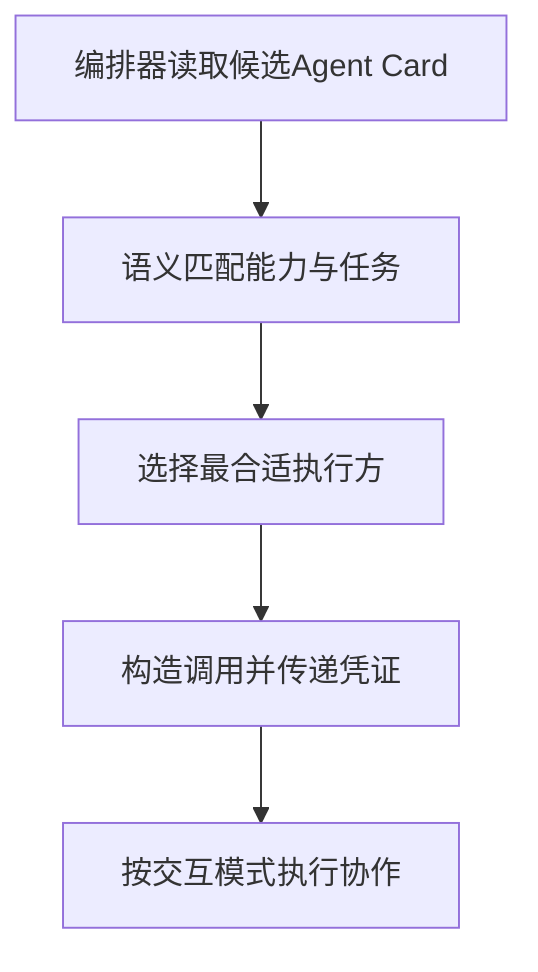

Agent Card 是 A2A 协议中定义的**机器可读的能力描述文件**，通常是放在 Agent 服务端点约定路径下的一份 JSON 文档（类似 `/.well-known/agent-card.json`），对外公开声明"我是谁、我能做什么、怎么找我、需要什么凭证"。

## Agent Card 包含哪些信息

| 信息类别 | 具体内容 |
|---------|---------|
| 身份标识 | 名称、版本、提供方 |
| 自然语言描述 | 用来说服别的 Agent 或调度器"该把任务交给我" |
| 能力列表 | 支持的任务类型与技能 |
| 输入输出模式 | 结构化的参数与结果定义 |
| 交互模式 | 是否支持流式、是否支持多轮 |
| 服务端点与传输方式 | 如何找到并调用该 Agent |
| 认证方案 | OAuth、API Key 等 |

## 发现阶段：动态发现与能力匹配

Agent Card 是 Agent 的**名片与目录条目**。当一个编排器需要找执行方时，通过读取候选 Agent 的 Card，判断其能力是否匹配当前任务、交互模式是否兼容、认证是否可满足。

:::tip
A2A 的发现是**运行时的、动态的**——编排器无需预先硬编码协作方是谁，这是它与"代码里写死调用哪个服务"的本质差异。
:::

## 协作阶段：契约与调用方式

Agent Card 是**契约**。技能声明的输入输出模式定义了双方的数据边界，调用方据此构造请求、解析响应；认证方案定义了调用凭证如何传递；交互模式声明决定了调用方该用哪种调用方式（同步、流式还是异步任务）。

## 信任边界：自我声明不等于验证

Card 里的描述是 Agent **自我声明**的，不等于被验证。生产上还需要**信任等级标注**（私有/团队/公开）、发布审核、以及运行时对实际行为的校验（对方是否如声明般可靠）。

:::caution
**不能把 Card 当成安全凭据。**
:::

## 可路由性：语义匹配与选路准确率

大模型或调度器读取多个 Card 后进行**语义匹配**，选出一个最合适的执行方并构造调用。这实际上把"多 Agent 编排"的一部分决策交给了**模型 + 结构化描述**。

:::tip
Card 描述的质量直接决定选路准确率——写得含糊会导致选错，写得具体能显著提升路由效果。这与工具描述的作用完全一致。
:::

## 与工具描述的异同

| 维度 | Agent Card | 工具描述 |
|------|-----------|---------|
| 相同点 | 都是给模型读的契约、都直接影响选择准确率 | 同左 |
| 作用对象 | Agent 是对等协作方 | 工具是被调用的能力 |
| 生命周期 | Agent 是长期在线的服务 | 工具常随应用版本变化 |
| 信任模型 | Agent 往往是独立团队甚至独立厂商维护的 | 工具通常同属一个系统 |

## 实践建议

| 建议 | 说明 |
|------|------|
| 能力描述具体且不重叠 | 避免多个 Agent 声称能做同一件事 |
| 输入输出模式严格 | 结构化定义参数与结果 |
| 明确标注不擅长的场景 | 给编排器提供排除依据 |
| 区分交互模式 | 同步、流式、异步 |
| 支持版本演进 | 能力变更时可平滑更新，避免运行中的编排器行为突变 |
