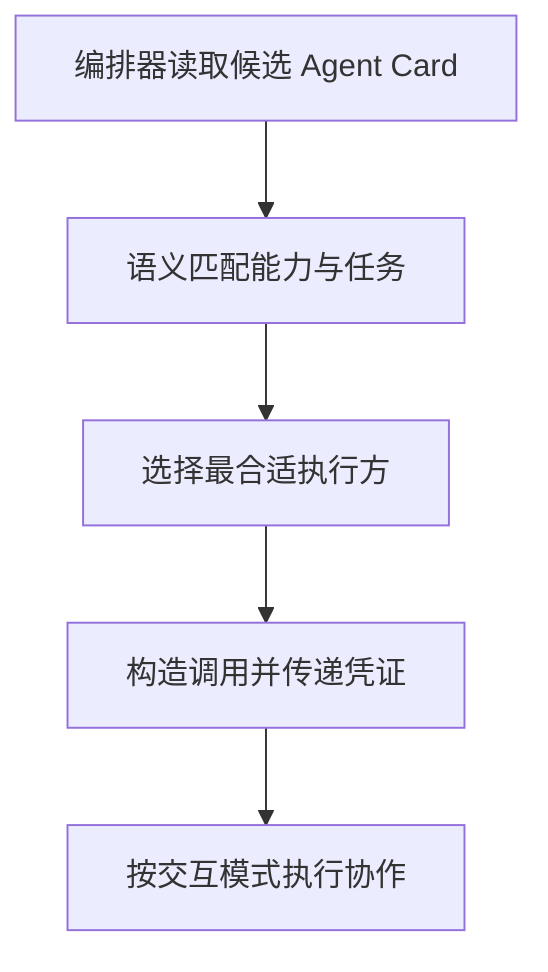

Agent Card 是 A2A 协议中定义的**机器可读的能力描述文件**，通常是放在 Agent 服务端点约定路径下的一份 JSON 文档（类似 `/.well-known/agent-card.json`），对外公开声明"我是谁、我能做什么、怎么找我、需要什么凭证"。它同时扮演两个角色：**发现阶段的名片与目录条目**，让编排器在运行时找到合适的执行方；**协作阶段的调用契约**，规定双方怎么交换数据、怎么传凭证、怎么调用。

## Agent Card 里到底声明了什么

Card 不是给人看的宣传页，而是给编排器和模型读的结构化文档。它要把"能不能接这个活"讲清楚，通常覆盖以下几类信息：

| 信息类别 | 具体内容 |
|---------|---------|
| 身份标识 | 名称、版本、提供方 |
| 自然语言描述 | 用来说服别的 Agent 或调度器"该把任务交给我" |
| 能力列表 | 支持的任务类型与技能 |
| 输入输出模式 | 结构化的参数与结果定义 |
| 交互模式 | 是否支持流式、是否支持多轮 |
| 服务端点与传输方式 | 如何找到并调用该 Agent |
| 认证方案 | OAuth、API Key 等 |

其中身份标识与能力列表决定"能不能做"，输入输出模式与交互模式决定"怎么对接"，服务端点与认证方案决定"怎么连上、用什么凭证连"，自然语言描述则是给模型做语义判断的入口。这几类信息缺一块，编排器就得靠猜或靠人工配置补齐。

## 发现阶段：让编排器不必硬编码协作方

Agent Card 是 Agent 的**名片与目录条目**。当一个编排器需要找执行方时，它会读取候选 Agent 的 Card，据此判断三件事：**能力是否匹配当前任务**、**交互模式是否兼容**、**认证是否能满足**。三项都过关，才会进入调用环节。

:::tip
A2A 的发现是**运行时的、动态的**——编排器无需预先硬编码协作方是谁，这是它与"代码里写死调用哪个服务"的本质差异。
:::

硬编码的做法在协作方数量少时没问题，一旦参与方会增减、会升级、由不同团队各自维护，写死的配置就会很快腐化。Card 的价值就在于把"有哪些协作方、各自能做什么"变成可以随时拉取的运行时信息。

## 协作阶段：Card 是一份调用契约

找到人之后，Card 还要回答"怎么合作"。技能声明的**输入输出模式**定义了双方的数据边界，调用方据此构造请求、解析响应；**认证方案**定义了调用凭证如何传递；**交互模式**声明决定了调用方该用哪种调用方式——同步等结果、流式拿过程，还是提交一个异步任务后轮询状态。

正因为这几项是**声明式**的，编排逻辑才可以写成通用代码：读 Card、比能力、按模式调用，而不必为每个协作方写一套适配器。Card 变更时，只要模式演进保持兼容，运行中的编排器行为不会突变。

## 可路由性：描述写得好不好，直接决定选路准确率

大模型或调度器读取多个 Card 后进行**语义匹配**，选出一个最合适的执行方并构造调用。这实际上把"多 Agent 编排"的一部分决策交给了**模型 + 结构化描述**。

:::tip
Card 描述的质量直接决定选路准确率——写得含糊会导致选错，写得具体能显著提升路由效果。这与工具描述的作用完全一致。
:::

落到实践上，有几点直接可做：

- **能力描述具体且不重叠**：避免多个 Agent 声称能做同一件事，让路由有明确答案。
- **输入输出模式严格**：把参数与结果都用结构化 schema 定义，不用自由文本代替。
- **明确标注不擅长的场景**：给编排器提供排除依据，负向信息往往比正向描述更有区分度。
- **区分交互模式**：同步、流式、异步各自适配不同任务，别让调用方猜。
- **支持版本演进**：能力变更时可平滑更新，避免运行中的编排器行为突变。

## 信任边界：自我声明不等于验证

Card 里的描述是 Agent **自我声明**的，不等于被验证。一个 Agent 可以把自己的能力写得很漂亮，也可以声称支持某种认证方式实际却不落实，编排器读到的只是它的"自我介绍"。

生产上还需要额外的机制把这份自述变成可信信息：**信任等级标注**（私有、团队、公开）、发布审核，以及运行时对实际行为的校验——对方是否如声明般可靠、返回质量是否稳定。

:::caution
**不能把 Card 当成安全凭据。** 鉴权与授权必须在调用链路上按身份独立完成，Card 只提供"该问谁、怎么问"的信息。
:::

## 与工具描述的异同

Card 的思路和工具描述高度相似，差异在于作用对象和维护边界：

| 维度 | Agent Card | 工具描述 |
|------|-----------|---------|
| 相同点 | 都是给模型读的契约、都直接影响选择准确率 | 同左 |
| 作用对象 | Agent 是对等协作方 | 工具是被调用的能力 |
| 生命周期 | Agent 是长期在线的服务 | 工具常随应用版本变化 |
| 信任模型 | Agent 往往是独立团队甚至独立厂商维护的 | 工具通常同属一个系统 |

所以写 Card 时的直觉可以从写工具描述迁移过来，但要多考虑一层：对等协作方会演进、会下线、会由不受调用方控制的团队改动，契约的版本与信任问题因此比工具描述重得多。

## 常见追问

**Q：Agent Card 和 MCP 的工具列表是一回事吗？**
A：不是。MCP 的工具列表描述"本应用内可被调用的函数"，主语是本地应用；Agent Card 描述"一个独立 Agent 主体能承接什么任务、怎么与它协作"，主语是对等的协作方。

**Q：编排器怎么知道该读哪个 Agent 的 Card？**
A：先把候选范围定下来（来自目录、配置或发现机制），再逐一拉取 Card 做能力与交互模式的匹配。Card 解决的是"拿到候选之后怎么判断"，不是"世界上有哪些 Agent"。

**Q：Card 里写的能力不准确会怎样？**
A：表现为选路错误和协作失败。编排器把任务交给做不了的 Agent，或在调用时才发现输入输出对不上、认证方式不兼容。所以描述质量本身就是系统工程的一部分。

## 易错点

- **把 Card 当安全凭据**：Card 只声明"需要什么凭证"，不能证明对方可信，也不能替代身份鉴权与授权。
- **只写能力不写边界**：只列"我能做什么"、不写输入输出模式和不擅长场景，路由时缺少排除依据，容易选错。
- **忽视交互模式差异**：把只支持异步任务的 Agent 当同步服务调用，会在超时和状态管理上翻车。
- **把 Card 当成静态配置**：协作方会升级、会下线，发现必须发生在运行时，不能一次性抄进代码里。

## 一句话记住

:::tip
Card 是 Agent 的名片与调用契约，靠它被发现与调用，但它不是安全凭据。
:::
