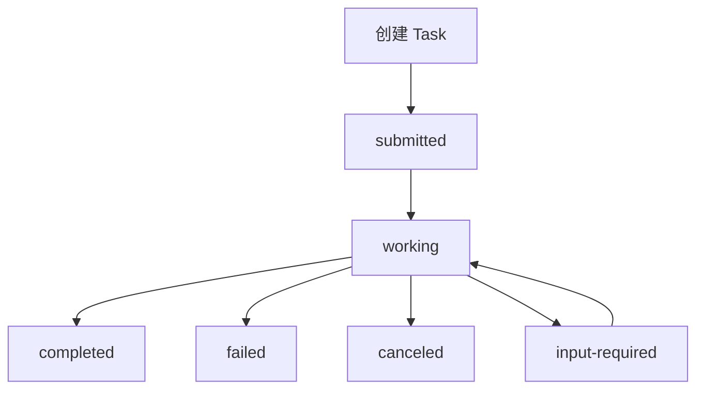

A2A 的工作原理可以用一句话概括：**每个 Agent 通过一张 Agent Card 公开自己的能力，通过 Task 把协作状态托管在服务端，通过流式更新暴露过程，通过 Artifact 交付成果。**它与 MCP 的差别不在传输层而在语义：MCP 是调用自己程序里的一个函数，A2A 是把一件事托付给另一个独立主体并跟进进度，所以它才需要任务生命周期、多轮消息与拒绝语义。

## 基于标准 Web 基础设施

A2A 复用 **HTTP + JSON**，Server 暴露 HTTP 端点承载任务 API。这带来两个直接好处：**企业网络与网关策略天然适用**——出网白名单、证书、鉴权、限流沿用现成那一套，不必为一个新协议栈在防火墙上开口子；**可用现成工具观测与调试**——请求能被抓包、被网关日志记录、被链路追踪串起来。反过来，如果协议自带一套私有传输，这些能力全部要重做，接入成本会成倍上升。

## 发现与匹配

### 发现阶段

编排方在需要协作时，**拉取候选 Agent 的 Agent Card**（约定路径下的 JSON），解析出能力、技能、输入输出模式、交互模式与认证要求。**发现是运行时的、动态的** —— 编排方不必预先硬编码协作方。注意 Card 是公开的能力声明，它只写"要求哪种认证"，本身不带凭据。

### 匹配与路由

编排方（人或模型）依据 Card 中的**自然语言描述与结构化能力**，筛选出合适的执行方并决定委派方式。筛选既可以由规则做（技能标签精确匹配），也可以由模型做（语义匹配并权衡成本与延迟）。

:::tip[面试加分点]
Card 描述的准确度直接决定选路准确率，这与工具描述的作用完全一致。
:::

## 任务生命周期

### 任务发起

Client 按 Card 声明的**输入输出 schema** 构造请求，**用自己 Agent 的身份凭证**发起任务调用，Server 创建一个 **Task**，分配任务 id，进入 `submitted` 状态。调用方拿到 id 就可以走开，不必挂在那里等结果。

### 流式执行与状态更新

Server 异步推进任务，状态从 `submitted` → `working` → 终态（`completed` / `failed` / `canceled`），过程中通过**流式通道推送状态变更与中间产物**。

| 状态 | 含义 | 说明 |
|------|------|------|
| `submitted` | 任务已创建 | 等待处理 |
| `working` | 执行中 | 可推送中间产物 |
| `input-required` | 等待补充输入 | 支持多轮协作 |
| `completed` | 成功完成 | 交付 Artifact |
| `failed` | 执行失败 | 可携带错误信息 |
| `canceled` | 已取消 | 由调用方或服务方触发 |

:::caution[易错点]
注意 `input-required` 状态 —— 这允许 Server **中途反问调用方**补充信息，是支持多轮协作的关键。
:::

### 任务管理

规范定义了查询状态、订阅更新、取消任务等操作，使长任务可异步推进、可中断。这几项操作合起来解决的是"断线之后怎么办"：按 task id 补查状态、重新订阅更新，进度就能接回来。

### 凭据与鉴权

**每个 Agent 用自己的身份与对方通信**，凭证在请求中传递但**不写入消息内容**。Server 依据验证后的身份做**资源级鉴权**，并可**声明拒绝**某些委派。

## 消息与产物交付

### 多轮消息往来

双方通过 **Message** 交换结构化内容（文本、文件、数据部件），支持澄清、协商与逐步收敛。多轮不是协议缺陷，而是长程协作的常态：对方可能缺材料、可能要先确认边界，这些都在消息通道里解决。

:::note
消息是过程沟通，不等于交付物。
:::

### 产物交付

最终成果以 **Artifact** 形式交付，可以是文件、报告或结构化数据。**产物通常较大**，实践中同样需要"**摘要 + 引用**"策略（大产物外置、只回摘要与可寻址引用）。

## 与 MCP 的分工对比

### 原理层面的分工

MCP 的原理是"**客户端拉取工具列表 → 调用工具 → 回填结果**"，主语始终是本地应用；A2A 的原理是"**对方是一个独立主体，它有自己的一摊事要做**" —— 所以需要任务生命周期、流式状态、多轮消息、产物交付与拒绝语义。**前者是函数调用，后者是任务委托。**

### 直观对比

调用 MCP 工具像"**调用自己程序里的一个函数**"；使用 A2A 像"**把一件事托付给另一个部门的同事，然后跟进他做到哪一步**"。

| 维度 | MCP | A2A |
|------|-----|-----|
| 本质 | 函数调用 | 任务委托 |
| 主语 | 本地应用 | 独立 Agent |
| 生命周期 | 无 | 有（submitted → working → 终态） |
| 交互 | 请求-响应 | 流式状态 + 多轮消息 |
| 产物 | 直接回填结果 | Artifact 交付 |
| 拒绝语义 | 无 | 可声明拒绝 |

## 面试怎么答

1. 先用一句话概括核心原理：每个 Agent 通过 Agent Card 公开能力，通过 Task 托管状态，通过流式更新暴露过程，通过 Artifact 交付成果。
2. 用"调用自己程序里的函数" vs "托付给另一个部门的同事"这个类比来对比 MCP 与 A2A，说明前者是函数调用、后者是任务委托。
3. 强调 `input-required` 状态是支持多轮协作的关键，体现对协议细节的理解。
4. 提到 Card 描述准确度决定选路准确率，与工具描述的作用完全一致。

## 易错点

- 把 **Message 当成交付物**：消息只是过程沟通，用来澄清与协商；下游要的是确定性产物，成果必须走 Artifact。
- 把 **`input-required` 当成失败**：它是可继续的中间态，收到后应补消息回到 `working`，误判等于白扔掉一个本可完成的任务。
- 把 **A2A 当成远程函数调用**：远程调用只有请求-响应，A2A 多了任务生命周期、流式状态、取消与拒绝语义，按 RPC 的思路设计会漏掉关键约束。
- 把 **凭证写进消息内容**：凭证在请求中传递，不落在消息体里；身份由 Server 验证后做资源级鉴权，写进正文等于把凭据当聊天记录传播。

## 常见追问

Q：为什么 A2A 不自己定义一套传输协议，反而复用 HTTP + JSON？
A：因为传输层不是它要解决的问题。复用标准 Web 技术，网关、白名单、鉴权、限流、链路追踪全部可以直接继承；自定义协议抽象层次更低，接入成本反而更高。

Q：协作状态到底由谁保存？
A：由 Server 托管。Client 只持有 task id 与本地视图，所以断线后可以按 id 补查状态、重新订阅更新，天然支持长任务。

Q：发现阶段完全靠模型做可以吗？
A：可以，但不该只有模型。Card 里的结构化能力适合规则精确筛选，自然语言描述适合语义匹配，两者结合比单纯依赖模型更稳，也便于权衡成本与延迟。

Q：A2A 会取代 MCP 吗？
A：不会，两者主语不同。MCP 让本地应用取用工具与资源，是函数调用；A2A 让独立 Agent 之间互相委托任务。真实系统里通常并存：Agent 内部用 MCP 接工具，Agent 之间用 A2A 协作。

## 一句话记住

:::tip
A2A 是任务委托：Card 找人、Task 跟进、Artifact 交付。
:::
