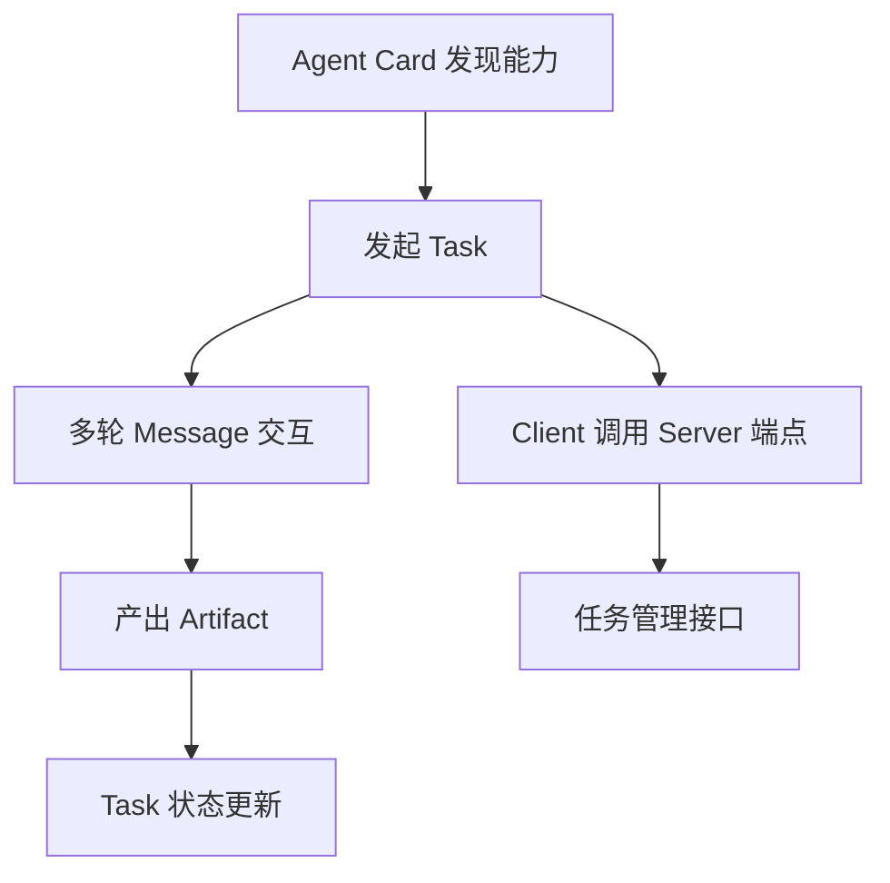

A2A（Agent2Agent）是 Google 发起、后捐赠给开源基金会的 **Agent 间通信协议**，核心架构是**对等协作而非中心编排**，主要组件是 **Agent Card / Task / Message / Artifact**，再加上 **Client / Server 端点**与**任务管理接口**。它解决的是这样一类问题：让**独立部署、可能由不同团队甚至不同厂商维护的 Agent** 能够相互发现、协商与协作，完成单个 Agent 无法完成的任务。

## 核心架构：对等协作而非中心编排

A2A 不规定谁该做编排者，**每个 Agent 既是服务端（暴露能力）也是客户端（调用他人能力）**，协作由具体任务驱动，可以跨组织边界。

- **方向对等**：同一套协议里，一个 Agent 既可以被别人调用，也可以主动去调用别人，没有"只能当服务端"的角色限制。
- **没有强制的中心**：协议不要求存在一个全局编排器，谁来做编排由具体场景里的任务决定，不由协议规定。
- **可跨组织**：对端可能是别的团队、别的厂商部署的 Agent，所以能力必须可声明、身份必须可验证、委派必须可拒绝。

架构上最值得借鉴的一点是：**Agent Card 让协作关系从"编译期绑定"变成"运行期发现"**——编排器不必预先知道协作方是谁、部署在哪、有什么能力，这在跨组织的场景里是刚需。

## Agent Card：运行期发现的能力契约

每个 Agent 的**机器可读能力描述**，放在服务端点约定路径下（如 `/.well-known/agent-card.json`）。它是**发现机制 + 能力契约 + 信任凭据**三合一。

- **发现机制**：调用方按约定路径拉取这份描述，就知道对端会做什么，不必事先硬编码。
- **能力契约**：声明技能清单以及每个技能的输入输出模式，调用方据此构造合法请求。
- **信任凭据**：同时声明认证方案，调用方据此知道该用什么方式证明自己的身份。

| 内容类别 | 具体字段 |
|---------|---------|
| 身份标识 | 名称、版本、提供方 |
| 自然语言描述 | 说明擅长什么 |
| 能力与技能列表 | 技能清单 |
| 输入输出模式 | 每个技能的输入输出模式 |
| 交互模式 | 是否支持流式、是否支持多轮 |
| 服务端点与传输方式 | 端点地址、传输协议 |
| 认证方案 | 认证机制 |

## Task 与任务管理接口：把协作状态托管在服务端

Task 是协作的**基本单位**，有状态、有生命周期。状态贯穿任务始终，并支持**流式状态更新**与**中间产物的增量推送**（Artifact）。

:::note
这是 A2A 与"一次 HTTP 请求-响应"最本质的区别：一次请求表达不了"还在跑、做到哪了、要你补一句、我想撤单"。
:::

Task 状态包括：`submitted` / `working` / `input-required` / `completed` / `failed` / `canceled` 等。

任务管理接口方面，规范定义了**发起任务、查询任务状态、订阅更新流、取消任务**等操作，让长任务可以异步推进、可以中断。承载这些操作的是 **Client / Server 端点**：A2A 复用 Web 基础设施，Server 暴露 HTTP 端点承载任务 API，Client 通过调用端点发起任务，这让 A2A 天然适配企业网络与网关策略。

## Message 与 Artifact：过程沟通与交付物

Message 是 Task 内部的**多轮往来载体**，支持**结构化内容**（文本、文件、数据部件），多轮消息是 A2A 支持澄清、协商、多轮协作的基础。

Artifact 是任务执行过程中产出的**具体成果**（文件、报告、结构化数据）。

| 维度 | Message | Artifact |
|------|---------|----------|
| 定位 | 过程沟通 | 交付物 |
| 作用 | 澄清、协商、补充输入 | 交付任务成果 |
| 节奏 | 多轮往来，贯穿任务 | 可在执行中增量推送 |
| 典型体量 | 通常较小 | 通常较大 |
| 处理策略 | 随状态流一起推送 | 摘要 + 引用，大产物外置 |

:::caution
Message 与 Artifact 容易混淆：**Message 是过程沟通，Artifact 是交付物**。产物通常较大，因此需要摘要 + 引用策略。
:::

## 组件如何串起一次协作

1. **发现**：Client 拉取对方的 Agent Card，从技能清单、输入输出模式、交互模式与认证方案里判断"它能不能干、我该怎么调"。
2. **发起**：Client 按 Card 声明的模式构造请求，通过 Server 端点调用，Server 创建 Task，任务进入 `submitted`，再由任务管理接口负责后续的查询、订阅与取消。
3. **推进**：任务进入 `working` 后，双方用 Message 多轮往来，需要补充信息时停在 `input-required`，过程中的状态变更通过流式通道推送。
4. **交付**：任务进入 `completed` 时交付 Artifact；失败或撤单则是 `failed` / `canceled`。

## 与 MCP 的组件分工

| 协议 | 核心组件 | 职责 |
|------|---------|------|
| MCP | Host / Client / Server 与 Tools / Resources / Prompts | 管"**工具与数据**" |
| A2A | Agent Card / Task / Message / Artifact | 管"**协作中的 Agent**" |

:::tip
**一个 Agent 通常同时是 MCP Client（取工具）和 A2A Server（供协作）**。
:::

## 面试怎么答

1. 先一句话定义 A2A 协议：Agent 间通信协议，让独立部署的 Agent 相互发现、协商与协作。
2. 点明核心架构是对等协作而非中心编排，每个 Agent 既是服务端也是客户端。
3. 按顺序说出四个核心组件：Agent Card（能力描述）、Task（协作单位）、Message（多轮通信）、Artifact（交付产物）。
4. 对比 MCP 的分工：MCP 管工具与数据，A2A 管协作中的 Agent，一个 Agent 可同时是 MCP Client 和 A2A Server。
5. 最后强调架构亮点：Agent Card 让协作关系从编译期绑定变成运行期发现，跨组织场景刚需。

## 常见追问

**Q：A2A 和 MCP 是竞争关系吗？**
A：不是。MCP 解决"Agent 怎么用工具和读数据"，A2A 解决"Agent 之间怎么把任务托付出去"，两者管的对象不同，一个 Agent 通常同时是 MCP Client 和 A2A Server。

**Q：为什么要 Task 这种有状态的东西，一次 HTTP 请求-响应不够吗？**
A：单次请求表达不了长时间执行、中途澄清、进度可见和取消；Task 把状态托管在服务端，配合流式更新与增量产物，才能支撑真实的长任务协作。

**Q：`input-required` 状态是干嘛的？**
A：它让 Server 在执行中途反问调用方补充信息，是 A2A 支持澄清、协商与多轮协作的关键状态，忽略它就会把 A2A 误解成同步一问一答。

**Q：Agent Card 写得不准确会有什么后果？**
A：Card 是选路依据，描述一旦偏离真实能力，调用方就会把任务派给不合适的 Agent。它和工具描述的作用一致：写准了才有效。

## 易错点

- **把 Message 当成交付物**。Message 是过程沟通，Artifact 才是最终成果；并且产物通常较大，实践中要用"摘要 + 引用"而不是整包塞进消息。
- **以为 A2A 规定了中心编排器**。协议不指定谁做编排，每个 Agent 双向都能当服务端和客户端，编排者是任务场景决定的。
- **以为 A2A 要另起网络栈**。它复用 Web 基础设施，Server 暴露 HTTP 端点承载任务 API，所以企业网络与网关策略天然适用。
- **以为 Task 只有成功和失败两种终态**。还有 `canceled`；也别忘了 `input-required` 这个中间态，它才是多轮协作的入口。

## 一句话记住

:::tip
**Card 管发现，Task 管状态，Message 管沟通，Artifact 管交付。**
:::
