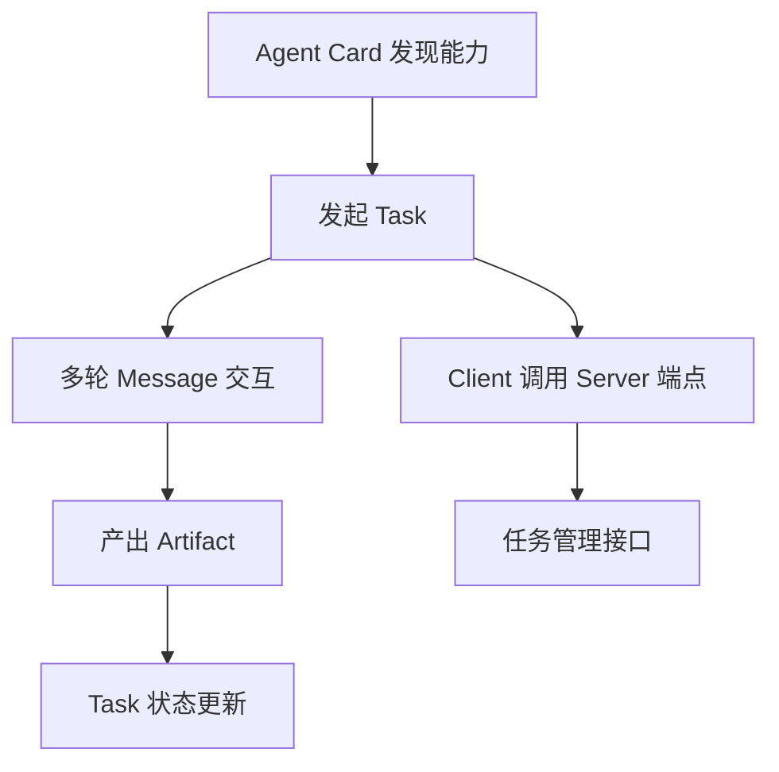

## 什么是 A2A 协议

A2A（Agent2Agent）是 Google 发起并捐赠给开源基金会的 **Agent 间通信协议**，让**独立部署、可能由不同团队甚至不同厂商维护的 Agent** 能够相互发现、协商与协作完成单个 Agent 无法完成的任务。

## 核心架构：对等协作而非中心编排

A2A 不规定谁该做编排者，每个 Agent 既是**服务端**（暴露能力）也是**客户端**（调用他人能力），协作由具体任务驱动，**可跨组织边界**。

架构上最值得借鉴的一点是：**Agent Card 让协作关系从"编译期绑定"变成"运行期发现"** —— 编排器不必预先知道协作方是谁、部署在哪、有什么能力，这在跨组织的场景里是刚需。

## 核心组件

A2A 的核心组件包括 **Agent Card / Task / Message / Artifact**，以及 **Client / Server 端点** 和 **任务管理接口**。

### Agent Card（智能体卡片）

每个 Agent 的**机器可读能力描述**，放在服务端点约定路径下（如 `/.well-known/agent-card.json`）。它是**发现机制 + 能力契约 + 信任凭据**三合一。

| 内容类别 | 具体字段 |
|---------|---------|
| 身份标识 | 名称、版本、提供方 |
| 自然语言描述 | 说明擅长什么 |
| 能力与技能列表 | 技能清单 |
| 输入输出模式 | 每个技能的输入输出模式 |
| 交互模式 | 是否支持流式、是否支持多轮 |
| 服务端点与传输方式 | 端点地址、传输协议 |
| 认证方案 | 认证机制 |

### Task（任务）

协作的**基本单位**，有状态、有生命周期。Task 状态贯穿始终，并支持**流式状态更新**与**中间产物的增量推送**（Artifact）。

:::note
这是 A2A 与"一次 HTTP 请求-响应"最本质的区别。
:::

Task 状态包括：`submitted` / `working` / `input-required` / `completed` / `failed` / `canceled` 等。

### Message（消息）

Task 内部的多轮往来载体，支持**结构化内容**（文本、文件、数据部件）。**多轮消息**是 A2A 支持澄清、协商、多轮协作的基础。

### Artifact（产物）

任务执行过程中产出的**具体成果**（文件、报告、结构化数据）。

:::caution
Message 与 Artifact 容易混淆：Message 是**过程沟通**，Artifact 是**交付物**。产物通常较大，因此需要摘要 + 引用策略。
:::

### Client / Server 端点

A2A 复用 Web 基础设施：Server 暴露 HTTP 端点承载任务 API，Client 通过调用端点发起任务。这让 A2A 天然适配企业网络与网关策略。

### 任务管理接口

规范定义了**发起任务、查询任务状态、订阅更新流、取消任务**等操作，让长任务可以异步推进。

## 组件协作关系

## 与 MCP 的组件分工

| 协议 | 核心组件 | 职责 |
|------|---------|------|
| MCP | Host / Client / Server 与 Tools / Resources / Prompts | 管"**工具与数据**" |
| A2A | Agent Card / Task / Message / Artifact | 管"**协作中的 Agent**" |

:::tip
**一个 Agent 通常同时是 MCP Client（取工具）和 A2A Server（供协作）**。
:::

## 面试怎么答

1. 先一句话定义 A2A 协议：Agent 间通信协议，让独立部署的 Agent 相互发现、协商与协作。
2. 点明核心架构是对等协作而非中心编排，每个 Agent 既是服务端也是客户端。
3. 按顺序说出四个核心组件：Agent Card（能力描述）、Task（协作单位）、Message（多轮通信）、Artifact（交付产物）。
4. 对比 MCP 的分工：MCP 管工具与数据，A2A 管协作中的 Agent，一个 Agent 可同时是 MCP Client 和 A2A Server。
5. 最后强调架构亮点：Agent Card 让协作关系从编译期绑定变成运行期发现，跨组织场景刚需。
