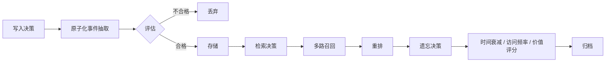

Agent 的记忆先按**时间尺度与作用范围**分成短期与长期两类：短期记忆就是上下文窗口本身，靠累积、滚动裁剪、摘要压缩和外置中间产物控制体积；长期记忆跨会话保留用户偏好与历史经验，核心是写入、检索、遗忘三段决策。按**内容形态**还可以分成工作记忆、情景记忆、语义记忆和程序性记忆四类，而工程上真正决定成败的是存储选型、元数据设计和冲突处理。

## 先分清三套分法

同一个问题有三套常见分法，先说明用的是哪一套，后面的实现方式才对得上号。

- **按时间尺度与作用范围**：短期记忆只服务当前任务，长期记忆跨会话、跨任务保留。
- **按内容形态**：认知科学的工作记忆、情景记忆、语义记忆、程序性记忆，工程上常借用这套划分来描述记忆「存的是什么」。
- **按存储位置**：上下文窗口内、模型外部存储（向量库、事件日志、知识图谱）、模型参数内（把稳定的领域知识固化进权重）。工程落地更常用这一套，因为它直接对应「放在哪里、怎么取出、怎么淘汰」。

三套分法不冲突，是同一件事的三个切面：内容形态决定该记什么，存储位置决定放在哪里，时间尺度决定留多久。面试时如果被问「有哪些类型」，先给出时间尺度这条主线，再补内容形态和存储位置，答案才立得住。

## 短期记忆：上下文窗口就是工作记忆

短期记忆保存**当前任务**的全部上下文：原始目标、近期对话、工具调用与返回、中间产物、任务状态。它通常就是上下文窗口本身，所以天然受窗口大小限制——把什么放进去、把什么挤出去，构成了短期记忆的全部工程问题。四种常见手段：

- **随消息列表累积**：消息直接追加到上下文，随对话轮次自然累积，最省事但迟早撑满。
- **滚动裁剪**：只保留最近 N 轮，丢弃更早的原始消息，实现最简单，代价是彻底忘记早期结论。
- **摘要压缩**：把旧消息压成结构化摘要，保留关键信息、丢弃细节，压缩比高，但要额外一次模型调用，且有信息损失。
- **外置中间产物**：把大体积中间产物（长文档、检索结果、代码文件）写到文件系统或对象存储，上下文里只留摘要加引用，需要时按引用取回。

:::tip[组合使用]
滚动裁剪与摘要压缩可以组合使用：先滚动裁剪只保留最近 N 轮，再把更早的消息压成结构化摘要，形成「近处留原文、远处留摘要」的两级结构。
:::

裁剪和压缩都要落在**轮次边界**上，不要从一条工具调用的中间切断。切断后工具结果会和它的调用分离，模型看到一个孤立的结果，只会给出错误解释。

## 长期记忆：写入、检索、遗忘三段决策

长期记忆跨会话、跨任务保留信息：用户偏好、历史经验、领域知识、过往任务的结论。它的实现不是「接一个向量库」这么简单，而是三段决策串成的流水线，任何一段缺位，记忆都会退化成噪声堆。

### 写入决策

做**原子化事件抽取**，把一段对话拆成一条条独立可复述的事实或经验，再评估新颖性、重要性、置信度、可复用性，不合格的直接丢弃。同一件事反复出现时应当合并或提升置信度，而不是存成多条重复记录。

### 检索决策

先**多路召回**再重排：语义向量负责「意思相近」，关键词负责专有名词与精确匹配，结构化过滤负责作用域与时间范围，图关系扩展负责多跳关联，最后统一重排，取前几条注入上下文。只用向量召回时，专有名词和否定语义会漏得很厉害。

### 遗忘决策

按**时间衰减、访问频率、价值评分**综合淘汰，并把淘汰项**归档而非物理删除**。归档保住了可追溯性，将来做冲突溯源、或者回答「以前这件事是怎么处理的」，还能查得到。



## 按内容形态划分的四类记忆

认知科学把记忆分成四类，工程上借用这套划分来说明「存的是什么」，这套划分也顺带决定了存储介质和检索方式。

- **工作记忆**：就是当前上下文，等于短期记忆，生命周期跟着任务走。
- **情景记忆**：记「具体发生过什么」，即某次任务的完整轨迹与结果，实现上存事件日志。
- **语义记忆**：记「客观事实与知识」，例如「该用户用 MySQL」，实现上存带来源与置信度的事实条目。
- **程序性记忆**：记「怎么做」，即经验规则、SOP、失败教训，实现上存可复用的策略与反思文本。

其中情景与语义的区分最容易被忽略：情景记忆回答「那次发生了什么」，语义记忆回答「事实是什么」，检索策略与时效要求完全不同。

| 维度 | 情景记忆 | 语义记忆 |
| --- | --- | --- |
| 回答的问题 | 那次发生了什么 | 事实是什么 |
| 存储内容 | 事件日志 | 带来源与置信度的事实条目 |
| 检索策略 | 按时间、按轨迹 | 按语义、按事实 |
| 时效要求 | 强时效，近期优先 | 弱时效，长期有效 |

:::note[检索策略不同]
情景记忆与语义记忆的检索策略和时效要求完全不同，不能混用同一套召回逻辑。实际系统里两者是上下游关系：一次任务结束后，从情景日志里抽取语义事实，情景留痕、语义沉淀，而不是二选一。
:::

## 按记忆类型选存储

存储选型跟着内容形态走，四条线各有各的合适介质。

| 记忆类型 | 存储选型 | 特点 |
| --- | --- | --- |
| 情景记忆 | 事件日志 / 时序库 / 对象存储 | 重写入、按时间检索 |
| 语义记忆 | 向量库加结构化数据库 | 向量做召回，字段做过滤与去重 |
| 程序性记忆 | 规则库 / 知识图谱 / 文档仓库 | 可版本化、可审阅 |
| 工作记忆 | 上下文加外部 `scratchpad` | 临时文件、KV 存储 |

选型的核心判断是「读多还是写多、按时间查还是按语义查」。情景记忆写多读少且强时间序，硬塞进向量库会既贵又难查；语义记忆必须同时支持模糊召回和精确过滤，所以向量库与结构化库要成对出现，缺一侧就会在去重和作用域过滤上出问题。

## 知识图谱型记忆解决什么

知识图谱型记忆是近年更受重视的形态，它把「实体—关系—属性」显式建模，解决三类向量库做不好的问题。

- **多跳推理**：A 的同事的项目用了什么框架，这类问题要沿实体链路走两步以上。
- **实体对齐**：不同工具返回的对象是否指同一实体，比如工单里的联系人和通讯录里的账号是不是同一个人。
- **冲突溯源**：同一属性有两个值时，能看到各自的来源与时间，再按权威性和时间决定采信哪个。

代价是**构建与维护成本高**、实体消歧困难。同名不同人、同一实体多种写法，抽取和归一化都要额外投入，抽取错了还会把错误沿关系链放大。所以常见做法是向量库打底、图谱只覆盖高价值的核心实体关系，而不是全量建图。

## 元数据与三条工程原则

每条记忆至少要有以下元数据，否则冲突解决、时效判断、作用域隔离全都无从谈起。

| 元数据字段 | 作用 |
| --- | --- |
| `来源` | 溯源与冲突解决 |
| `置信度` | 冲突解决与优先级判断 |
| `时间戳` | 时效判断与遗忘 |
| `有效期` | 时效判断与淘汰 |
| `作用域` | 会话 / 项目 / 用户 / 全局隔离 |
| `实体链接` | 实体对齐与多跳推理 |

一条实际落库的记忆大致长这样，元数据和正文并列存放。

```json
{
  "content": "该用户的生产库是 MySQL，不接受迁移到其他数据库",
  "scope": "user:10086",
  "source": "session-2026-10-20/turn-12",
  "confidence": 0.9,
  "createdAt": "2026-10-20T10:12:00Z",
  "expiresAt": null,
  "entities": ["user:10086", "db:mysql"]
}
```

工程上还有三条原则。

- **写入要克制**：噪声是最大敌人，宁缺毋滥，宁可这一轮不写，也不要写一条错的事实进去。
- **冲突要显式处理**：时间优先、权威性优先、作用域优先、置信度优先，四条都解决不了就向用户澄清，不要静默覆盖。
- **读写两侧都要做冲突检测**：写入时查既有记忆是否矛盾，检索时查同批结果是否互相打架，只在一侧做等于没做。

:::caution[写入克制]
写入要克制，噪声是最大敌人，宁缺毋滥。
:::

## 常见追问

**Q：短期记忆和长期记忆的边界在哪？**

A：按是否跨会话、跨任务划分。任务结束就丢弃的是短期；下一次新会话还要用的偏好、结论、经验是长期。同一份信息可以两边都有，短期里是原文，长期里是抽取后的事实条目。

**Q：为什么不把全部对话都塞进上下文，非要做摘要？**

A：窗口有限，成本也随长度上升，更关键的是噪声会稀释注意力——无关历史越多，模型越容易抓错重点。摘要不只是省 token，它是把「过程」压成「结论」。

**Q：向量检索不就是长期记忆吗？**

A：向量检索只是长期记忆的检索环节。写入时不做原子化和质量评估、遗忘时不做衰减清理，向量库很快会堆满重复又过期的碎片，召回质量持续下降。

**Q：记忆写错了怎么纠正？**

A：靠元数据兜底。按来源和置信度判断新旧可信度，用作用域隔离避免错误扩散，保留归档而不是物理删除以便回溯。用户明确纠正时，旧条目应标记失效，而不是悄悄删掉。

## 易错点

- **错的直觉**：记忆存得越多越聪明。**正确说法**：噪声是最大敌人，无关记忆既稀释注意力又带来错误暗示，写入必须克制、宁缺毋滥。
- **错的直觉**：长期记忆就是接一个向量库。**正确说法**：长期记忆是写入、检索、遗忘三段决策的流水线，只做检索等于只做了三分之一。
- **错的直觉**：短期记忆里被裁掉的消息就算忘了。**正确说法**：被裁剪的原文可能已经进了摘要或外置文件，真正的遗忘必须贯穿摘要与外部存储，否则「遗忘」是假的。
- **错的直觉**：冲突时用最新那条覆盖旧的就行。**正确说法**：按时间、权威性、作用域、置信度综合判断，判断不了就澄清；静默覆盖会丢掉可追溯性。

## 一句话记住

:::tip
短期管窗口，长期管三段决策；没有元数据的记忆等于噪声。
:::
