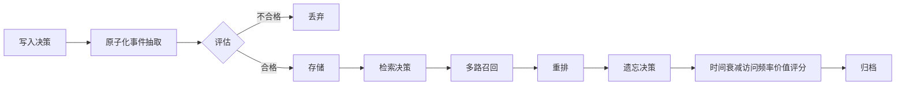

Agent 的记忆按**时间尺度与作用范围**可分为短期记忆与长期记忆，业界也常按**内容形态**分为工作记忆、情景记忆、语义记忆与程序性记忆；工程上更常用的是按“存储位置”分类。

## 短期记忆

短期记忆（Working Memory / Context）保存**当前任务**的上下文：原始目标、近期对话、工具调用与返回、中间产物、任务状态。它**通常就是上下文窗口本身**，因此天然受窗口大小限制。

### 随消息列表累积

消息直接追加到上下文，随对话轮次自然累积。

### 滚动裁剪

配合**滚动裁剪**只保留最近 N 轮，丢弃更早的原始消息。

### 摘要压缩

配合**摘要压缩**把旧消息压成结构化摘要，保留关键信息、丢弃细节。

### 外置中间产物

把大体积中间产物**外置到文件系统或对象存储**，上下文里只留摘要 + 引用。

:::tip[组合使用]
滚动裁剪与摘要压缩可以组合使用：先滚动裁剪只保留最近 N 轮，再把更早的消息压成结构化摘要。
:::

## 长期记忆

长期记忆（Long-term Memory）跨会话、跨任务保留信息：用户偏好、历史经验、领域知识、过往任务的结论。实现方式的核心是“写入决策 + 检索决策 + 遗忘决策”三段。

### 写入决策

做**原子化事件抽取**并评估新颖性、重要性、置信度、可复用性，不合格的直接丢弃。

### 检索决策

**多路召回**（语义向量 + 关键词 + 结构化过滤 + 图关系扩展）再重排。

### 遗忘决策

按**时间衰减、访问频率、价值评分**淘汰，并把淘汰项**归档而非物理删除**。

## 按内容形态划分的四类记忆

认知科学把记忆分为四类，工程上常借用这一划分。

### 工作记忆

工作记忆是当前上下文，就是短期记忆。

### 情景记忆

情景记忆是“具体发生过什么”（某次任务的完整轨迹与结果），实现上存事件日志。

### 语义记忆

语义记忆是“客观事实与知识”（如“该用户用 MySQL”），实现上存带来源与置信度的事实条目。

### 程序性记忆

程序性记忆是“怎么做”（经验规则、SOP、失败教训），实现上存可复用的策略与反思文本。

### 情景记忆与语义记忆的区别

区分情景与语义很重要——情景记忆回答“那次发生了什么”，语义记忆回答“事实是什么”，检索策略与时效要求完全不同。

| 维度 | 情景记忆 | 语义记忆 |
| --- | --- | --- |
| 回答的问题 | 那次发生了什么 | 事实是什么 |
| 存储内容 | 事件日志 | 带来源与置信度的事实条目 |
| 检索策略 | 按时间、按轨迹 | 按语义、按事实 |
| 时效要求 | 强时效，近期优先 | 弱时效，长期有效 |

:::note[检索策略不同]
情景记忆与语义记忆的检索策略和时效要求完全不同，不能混用同一套召回逻辑。
:::

## 记忆分层的存储选型

| 记忆类型 | 存储选型 | 特点 |
| --- | --- | --- |
| 情景记忆 | 事件日志 / 时序库 / 对象存储 | 重写入、按时间检索 |
| 语义记忆 | 向量库 + 结构化数据库 | 向量做召回，字段做过滤与去重 |
| 程序性记忆 | 规则库 / 知识图谱 / 文档仓库 | 可版本化、可审阅 |
| 工作记忆 | 上下文 + 外部 `scratchpad` | 临时文件、KV 存储 |

## 知识图谱型记忆

知识图谱型记忆是近年更受重视的形态。把“实体-关系-属性”显式建模，天然解决：

### 多跳推理

A 的同事的项目用了什么框架。

### 实体对齐

不同工具返回的对象是否指同一实体。

### 冲突溯源

同一属性有两个值时能看到各自来源与时间。

代价是**构建与维护成本高**，实体消歧困难。

## 记忆元数据：必备字段

每条记忆至少要有以下元数据，否则冲突解决、时效判断、作用域隔离全都无从谈起：

| 元数据字段 | 作用 |
| --- | --- |
| `来源` | 溯源与冲突解决 |
| `置信度` | 冲突解决与优先级判断 |
| `时间戳` | 时效判断与遗忘 |
| `有效期` | 时效判断与淘汰 |
| `作用域` | 会话 / 项目 / 用户 / 全局隔离 |
| `实体链接` | 实体对齐与多跳推理 |

:::tip[元数据是前提]
没有这些元数据，冲突解决、时效判断、作用域隔离全都无从谈起。
:::

## 记忆的三条工程原则

### 写入要克制

噪声是最大敌人，宁缺毋滥。

:::caution[写入克制]
写入要克制，噪声是最大敌人，宁缺毋滥。
:::

### 冲突要显式处理

时间优先、权威性优先、作用域优先、置信度优先，解决不了就澄清。

### 读写两侧都要做冲突检测

写入时查既有记忆、检索时查同批结果是否互相打架。
