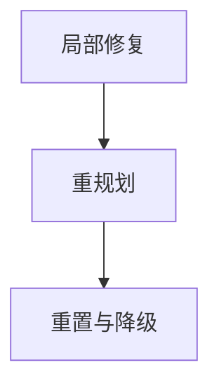

## 在线监测的前提：可观测轨迹

系统必须实时记录每一步的状态、动作、观测、耗时和产出，形成一条可回放的轨迹。在此基础上才谈得上监测。监测器最好独立于主循环运行，只做只读采样，避免干扰主流程的执行。

## 三类故障的检测

### 循环检测：三个角度叠加

| 检测角度 | 核心机制 | 特点 |
| --- | --- | --- |
| 签名重复 | 把最近若干步的动作和观测摘要归一化成签名，检测滑动窗口内的重复模式 | 最直接也最便宜的信号 |
| 语义相似循环 | 签名不同但语义高度相似的动作连续出现 | 需要向量相似度才能识别 |
| 无进展检测 | 判断任务状态或外部环境状态是否根本没有变化 | 连续多步状态增量为零，比任何文本模式都更可靠 |

此外，要把步数上限、`token` 预算、墙钟时间、工具错误率上升、同一错误码反复出现这类硬指标也纳入监测。

:::tip
签名重复是最直接也最便宜的循环信号，应作为第一道防线。
:::

### 目标漂移检测：可验证的约束

| 做法 | 核心机制 | 特点 |
| --- | --- | --- |
| 子目标清单硬约束 | 任务开始时把目标拆解成带验收条件的子目标清单，每完成一步用程序校验条件 | 硬约束，不依赖模型判断 |
| 独立判断器评分 | 周期性让独立轻量判断器评估当前步与原始目标的相关性并给出评分 | 滑动窗口加阈值加连续触发，避免误报 |
| 重新注入原始目标 | 把原始目标重新注入上下文，观察行为是否回归 | 行为明显改变说明此前确实发生了漂移 |

:::note
漂移是渐进的，单步检测很难，阈值必须建立在连续多步的趋势上。
:::

### 过早终止判定：查伪完成

核心是识别系统宣称完成但验收契约并未满足的情况。具体做法：

1. 拿子目标清单和硬约束逐条校验最终结论，凡是缺少证据支撑的断言都判定为未完成。
2. 检查是否有子任务仍处于未开始状态，或者覆盖率不足。
3. 答案中出现的所有事实性断言都要能溯源到具体的工具返回或检索片段，追溯不到的断言通常意味着提前收工时的幻觉。

## 恢复策略与工程机制

### 恢复策略：分层升级

| 层级 | 触发条件 | 具体动作 |
| --- | --- | --- |
| 局部修复 | 发现循环、漂移或伪完成 | 循环：中断重复模式，注入已尝试过的方案清单，强制换工具、换参数或换查询路径；漂移：重新注入目标和硬约束，回滚到漂移发生前的检查点；伪完成：把缺失项列成清单退回，要求补齐后再提交 |
| 重规划 | 局部修复无效 | 只重规划受影响的那部分子任务，重新分解剩余目标，或主动更换策略，如从检索降级为工具取权威数据 |
| 重置与降级 | 重规划仍无效 | 清空被污染的近期上下文从检查点重启，切换到更强的模型或换一套提示策略，把任务拆得更小，或直接升级为人工介入 |

### 工程机制：四个支撑

| 机制 | 作用 |
| --- | --- |
| 检查点与可回滚 | 状态快照存在外部存储，任何一步都能恢复 |
| 上下文清理 | 异常时把可疑的近期上下文裁剪或替换为摘要，避免污染继续传播 |
| 幂等与重放 | 恢复动作本身不能产生重复的副作用 |
| 看门狗与熔断 | 独立监控器持续采样，同一种失败重复到阈值就熔断并强制升级，而不是无限重试 |

## 三个容易踩的坑

:::caution
1. 恢复动作本身可能伤害正常流程，注入提示会改变后续行为，所以恢复必须幂等、可回滚，并且先试低成本手段。
2. 不能用模型自评“我是不是卡住了”作为唯一依据，模型对自己的循环和漂移往往毫无察觉。
3. 漂移检测的参考系本身也会漂移，所以要定期用原始目标重新对齐检测基准。
:::

## 评估：故障注入

构造一个包含循环、漂移、伪完成三类故障的基准集，人为制造重复动作、逐渐偏离的目标和提前收工的场景，分别统计检测率、误报率、恢复成功率、恢复之后的任务成功率以及额外消耗的成本。
