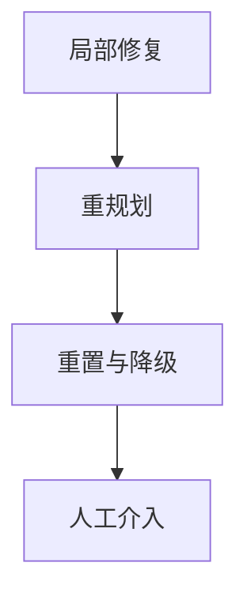

在线监测 Agent 的循环、漂移和过早终止，靠三件事：一条可回放的全步轨迹、分别针对三类故障的检测信号、以及一套分层的恢复动作。三类故障的检测思路并不相同——循环看动作模式是否在重复，漂移看当前步与原始目标的关系是否越走越远，过早终止则要把「模型宣称完成」和「验收契约已满足」区分开，凡是缺少证据支撑的断言一律判定为未完成。

## 前提：先有一条可回放的轨迹

系统必须实时记录每一步的状态、动作、观测、耗时和产出，形成一条可回放的轨迹，在此基础上才谈得上监测。监测器最好独立于主循环运行，只做只读采样，避免干扰主流程的执行。

这条轨迹至少要能回答三个问题：这一步做了什么（动作与参数）、看到了什么（工具返回或检索片段）、环境状态有没有发生变化。缺任何一项，后面的签名重复检测和无进展检测都没有数据可用——录不到状态增量，就只能靠文本模式猜，误报率会明显上升。

## 三类故障的检测

### 循环检测：三个角度叠加

| 检测角度 | 核心机制 | 特点 |
| --- | --- | --- |
| 签名重复 | 把最近若干步的动作和观测摘要归一化成签名，检测滑动窗口内的重复模式 | 最直接也最便宜的信号 |
| 语义相似循环 | 签名不同但语义高度相似的动作连续出现 | 需要向量相似度才能识别 |
| 无进展检测 | 判断任务状态或外部环境状态是否根本没有变化 | 连续多步状态增量为零，比任何文本模式都更可靠 |

此外，要把步数上限、`token` 预算、墙钟时间、工具错误率上升、同一错误码反复出现这类硬指标也纳入监测。

:::tip
签名重复是最直接也最便宜的循环信号，应作为第一道防线。
:::

### 目标漂移检测：可验证的约束

| 做法 | 核心机制 | 特点 |
| --- | --- | --- |
| 子目标清单硬约束 | 任务开始时把目标拆解成带验收条件的子目标清单，每完成一步用程序校验条件 | 硬约束，不依赖模型判断 |
| 独立判断器评分 | 周期性让独立轻量判断器评估当前步与原始目标的相关性并给出评分 | 滑动窗口加阈值加连续触发，避免误报 |
| 重新注入原始目标 | 把原始目标重新注入上下文，观察行为是否回归 | 行为明显改变说明此前确实发生了漂移 |

:::note
漂移是渐进的，单步检测很难，阈值必须建立在连续多步的趋势上。
:::

### 过早终止判定：查伪完成

核心是识别系统宣称完成但验收契约并未满足的情况。具体做法：

1. 拿子目标清单和硬约束逐条校验最终结论，凡是缺少证据支撑的断言都判定为未完成。
2. 检查是否有子任务仍处于未开始状态，或者覆盖率不足。
3. 答案中出现的所有事实性断言都要能溯源到具体的工具返回或检索片段，追溯不到的断言通常意味着提前收工时的幻觉。

## 恢复策略与工程机制

恢复不是单点动作，而是分层升级：先做最便宜的局部修复，无效再往上抬一级。

| 层级 | 触发条件 | 具体动作 |
| --- | --- | --- |
| 局部修复 | 发现循环、漂移或伪完成 | 循环：中断重复模式，注入已尝试过的方案清单，强制换工具、换参数或换查询路径；漂移：重新注入目标和硬约束，回滚到漂移发生前的检查点；伪完成：把缺失项列成清单退回，要求补齐后再提交 |
| 重规划 | 局部修复无效 | 只重规划受影响的那部分子任务，重新分解剩余目标，或主动更换策略，如从检索降级为工具取权威数据 |
| 重置与降级 | 重规划仍无效 | 清空被污染的近期上下文从检查点重启，切换到更强的模型或换一套提示策略，把任务拆得更小，或直接升级为人工介入 |

四个工程机制是上面这些动作能落地的前提：

| 机制 | 作用 |
| --- | --- |
| 检查点与可回滚 | 状态快照存在外部存储，任何一步都能恢复 |
| 上下文清理 | 异常时把可疑的近期上下文裁剪或替换为摘要，避免污染继续传播 |
| 幂等与重放 | 恢复动作本身不能产生重复的副作用 |
| 看门狗与熔断 | 独立监控器持续采样，同一种失败重复到阈值就熔断并强制升级，而不是无限重试 |

## 评估：用故障注入造数据

构造一个包含循环、漂移、伪完成三类故障的基准集，人为制造重复动作、逐渐偏离的目标和提前收工的场景，分别统计检测率、误报率、恢复成功率、恢复之后的任务成功率以及额外消耗的成本。只看检测率会误导人：一个把每一步都判成异常的检测器检测率接近满分，但它会让 Agent 几乎无法正常工作，所以误报和额外成本必须和检测率一起看。

## 常见追问

**Q：为什么不能直接让模型自评「我是不是卡住了」？**

A：模型对自己的循环和漂移往往毫无察觉，它确实会真诚地认为自己在推进。自评只能当辅助信号，硬判据要来自轨迹签名、状态增量和程序化验收。

**Q：循环检测为什么还要看状态增量，签名不就够了吗？**

A：签名只能覆盖文本层面的重复。参数略有差异、措辞换了一种写法的调用，签名会变，但状态可能一步没动；连续多步状态增量为零比任何文本模式都更可靠，两者叠加才稳。

**Q：漂移检测的阈值怎么定？**

A：不要按单步定，单步几乎测不出来。用滑动窗口看连续多步的趋势，再加阈值和连续触发条件，只有趋势持续变差才报，这样能压住误报。

**Q：恢复动作本身会不会把正常流程搞坏？**

A：会。注入提示会改变后续行为，回滚和重放还可能产生重复副作用。所以恢复必须幂等、可回滚，并且先试低成本手段，能局部修复就不要直接重置。

## 易错点

- **错的直觉**：恢复越彻底越好，出问题就清空上下文重启。**正确说法**：恢复动作本身可能伤害正常流程，注入提示会改变后续行为，重置还会丢掉已验证的进展；所以恢复必须幂等、可回滚，并按局部修复、重规划、重置与降级的顺序先试低成本手段。
- **错的直觉**：模型说完成了就是完成了。**正确说法**：宣称完成和验收契约满足是两件事，要拿子目标清单逐条校验，缺证据的断言算未完成。
- **错的直觉**：把模型自评当作循环和漂移的唯一判据。**正确说法**：模型对自己的循环和漂移往往毫无察觉，自评只能辅助。
- **错的直觉**：漂移检测的基准是固定的。**正确说法**：检测用的参考系本身也会漂移，要定期用原始目标重新对齐检测基准。

## 一句话记住

:::tip
可回放轨迹是地基，三类故障分开检测，恢复按成本从低到高升级。
:::
