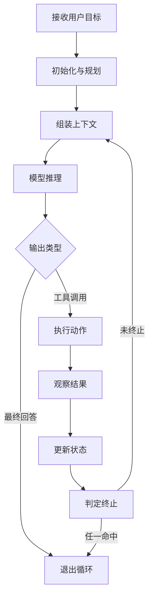

Agent 智能体的工作过程是一个**「感知 → 决策 → 执行 → 观察」的循环**，直到满足终止条件才退出。每一轮的具体动作是：组装上下文、模型推理、由程序执行模型选定的工具、把执行结果回填进消息列表，然后更新状态并判定是否结束；它与一次普通模型调用最大的区别，就在于**这个循环的存在**。

## 核心循环：感知 → 决策 → 执行 → 观察

把整个过程画成流程图，结构是这样：



图上能看出两个要点。**一是退出循环的出路有多条**：模型给出最终回答、程序化验收通过、超出预算、连续无进展、检测到循环，任一命中即退出，并不只有「模型说完了」这一条。**二是回到第 1 步时是重新组装上下文**，而不是在旧上下文后面接着往上堆——上一轮的工具结果与状态变化，都要按裁剪与排序规则重新进入下一次请求。

三个动作分别有明确含义：「感知」对应观察结果与召回资料，「决策」对应模型推理，「执行」对应工具调用。它们必须串成闭环才有价值：单次模型调用没有反馈回路，模型输出之后对错无从校验，所以它只能做「一次生成」，做不了「多步任务」。

## 第 0 步：初始化与规划

接收用户目标后，系统先做**任务理解与分解**，确定**可用的工具集**、**需要的上下文**、以及**验收标准**，同时初始化状态、预算与终止条件。

任务分解的详略因框架而异：有的在这一步生成任务清单与依赖图，把后续路径先框住；有的不做，让模型边做边拆、走到哪算哪。两种做法各有代价——先规划的执行更稳、步数更省，但计划赶不上变化时会白做功；边做边拆更灵活，但容易出现「走一步看一步」的漂移。

工具集在这里定下来，等于框定了模型的动作空间：没放进工具集的系统，模型连提都提不出来。验收标准也要在这一步说清楚，否则第 6 步判定终止时只能退化成「看模型自己的说法」，而模型经常在没做完时就宣称完成。

## 循环主体：组装上下文 → 模型推理 → 执行动作 → 观察结果

循环的每一轮都走同样四步，其中只有第二步是模型做的，其余三步全在程序侧。

### 第 1 步：组装上下文

把系统提示、目标、工具定义、检索到的资料、相关记忆、近期轨迹、当前状态**组装成一次模型请求**。这一层是**质量与成本的主要来源**——同样的模型、同样的任务，上下文里放什么、放多少、按什么顺序放，效果会差出明显档次。工具定义铺得太多，模型选不准；历史轨迹塞得太满，预算被无关内容吃掉；该给的资料没给，模型只能靠猜。

### 第 2 步：模型推理

模型基于上下文产出两种结果之一：**直接给出最终回答**，或**输出一个动作**（调用某个工具及其参数）。现代模型用**结构化的 `tool_call`** 表达动作意图，而不是解析自然语言——靠正则去猜「它好像想调用搜索」既不稳定，也没法做参数校验。

### 第 3 步：执行动作

由**工具网关**执行：先做**参数校验**与**权限裁决**，通过后真正调用外部系统（API、数据库、文件、代码沙箱）。**模型本身不执行任何东西**，执行权始终在程序手里。这也是整条链路的安全边界：模型可以提出「删掉这个目录」的意图，但是否真的执行、以什么权限执行，由网关决定。

### 第 4 步：观察结果

捕获执行结果（成功、失败、超时），把结果**规范化并裁剪**（大结果只留摘要与引用，错误只留可诊断的原因），**回填到消息列表**。失败时把错误信息也回传给模型，让它能**自我纠正**而不是直接终止。裁剪这一步不能省：把整页原始返回直接塞回去，下一轮的预算会被无关内容占掉，模型反而看不清重点。

把一轮写成伪代码大致是这样（示意，不是某个框架的真实接口）：

```text
messages = [system_prompt, user_goal]
while true:
    ctx = assemble(messages, tools, state)        # 第 1 步 组装上下文
    out = model(ctx)                              # 第 2 步 模型推理
    if out.final: break                           # 模型给出最终回答
    result = gateway.run(out.tool_call)           # 第 3 步 校验 + 权限 + 执行
    messages.append(normalize(result))            # 第 4 步 裁剪后回填
    state.update(result)                          # 第 5 步 更新状态与预算
    if should_stop(state): break                  # 第 6 步 判定终止
```

## 状态更新与终止判定

四步走完不等于这一轮结束，还要把痕迹记下来，并判断要不要继续下一轮。

### 第 5 步：更新状态

把这一步的动作、结果、耗时、token 消耗写入**事件日志**，更新任务状态机与预算账本，判断是否需要重规划。事件日志是后续回放与排障的原始材料；缺了它，线上出问题只能盯着最终回答去猜中间发生了什么。

### 第 6 步：判定终止

检查多重终止条件：

| 终止条件 | 说明 |
| --- | --- |
| 模型给出最终答案 | 模型直接输出最终回答 |
| 程序化验收通过 | 验收标准被满足 |
| 超出预算 | 步数 / token / 时间超限 |
| 连续无进展 | 多轮没有实质变化 |
| 检测到循环 | 状态重复出现 |

**任一命中则退出循环**，并做最终整理（汇总产物、输出结论、释放资源）。这些条件要当成并列的闸门一起检查，而不是排队等第一条：只留「模型给出最终答案」时，模型只要一直不给出，预算与时限就形同虚设。

### 第 7 步：未终止则回到第 1 步

开始下一轮迭代，重新组装上下文。注意关键词是「重新组装」：上一轮的消息、工具结果、状态变化都要重新过一遍裁剪与排序，而不是把历史原样追加到请求末尾。

## 三个贯穿特征

| 特征 | 含义 | 价值 |
| --- | --- | --- |
| 基于最新真实反馈 | 每一步都基于最新的真实反馈，而非模型内部一次性规划到底 | 可靠性的来源 |
| 状态全程记录 | 每一步的状态都被记录 | 可观测与可恢复的来源 |
| 预算与权限约束 | 每一步都受预算与权限约束 | 可控性的来源 |

这三条不是可选的加分项，而是循环能安全跑下去的前提：没有真实反馈就是盲跑，没有状态记录就无法排障与恢复，没有预算与权限约束就是放任它无限消耗、无限越权。

:::tip[记忆点]
这三个特征分别对应**可靠性、可观测性、可控性**，是 Agent 与一次性模型调用的本质差异。
:::

## 与工作流的本质区别

| 维度 | 传统工作流 | Agent 智能体 |
| --- | --- | --- |
| 每一步的决策者 | 人预先写死 | 模型运行时决定 |
| 运行路径 | 固定可复现 | 同一次运行不可完全复现 |

这也意味着**同一次运行的路径不可完全复现**——所以生产实现必须靠**事件溯源 + 确定性回放**来获得可审计性：把每一步的输入、输出、决策理由按序记下来，出问题时按日志重放，才能解释「它当时为什么这么选」。

选型上的分界也在这里：步骤能事先枚举、要求稳定可复现的（审批流、定时任务），用工作流；路径说不清、要靠中间结果决定下一步的，才用 Agent。反过来把 Agent 用在工作流能解决的地方，等于用不确定的逻辑去办确定的事。

## 工程排障的三个重点

:::caution[排障时最先看的地方]
1. **第 1 步（上下文组装）** 决定质量与成本上限；
2. **第 3 步（工具执行）** 是安全边界所在；
3. **第 6 步（终止判定）** 决定系统是否失控。
:::

三者对应三种典型症状：答得差、答得贵，先查上下文里塞了什么；出了越权或数据事故，先查工具网关的校验与权限裁决；跑个不停或提前收工，先查终止条件是否并列检查、阈值是否合理。排查顺序对了，大多数问题在两三个环节内就能定位，而不是从头读一遍全部轨迹。

## 常见追问

**Q：一次普通模型调用和 Agent 到底差在哪？**
A：差在有没有循环。普通调用是「输入一次、输出一次」，输出之后没有校验也没有下一步；Agent 把输出变成动作，执行结果作为新的输入回到模型，如此往复直到命中终止条件。

**Q：为什么说第 1 步组装上下文决定质量与成本上限？**
A：模型每一轮只能看见组装进去的东西。资料没给就只能猜，工具定义太杂就选不准，历史塞太满就白烧预算，所以同样的模型换个组装方式，效果与花费都能差出明显档次。

**Q：工具执行失败了，应该直接终止还是回传？**
A：回传。错误信息规范化后写回消息列表，模型才能换参数、换工具、换路径自我纠正；直接终止等于把一次可恢复的失败变成不可恢复的失败。真正的兜底交给第 6 步的预算与停滞判定。

**Q：Agent 和 workflow 该怎么选？**
A：看路径能不能事先确定。步骤固定、要求可复现可审计的用 workflow；路径依赖中间结果、只有运行时才知道下一步的才用 Agent，同时要补上事件溯源与确定性回放。

## 易错点

- 说「模型自己执行工具」。模型只输出结构化的 `tool_call`，真正执行的是程序侧的工具网关，参数校验与权限裁决也在程序侧，执行权从来不在模型手里。
- 认为工具报错就该结束任务。错误要规范化后回传，让模型自我纠正，直接终止会把可恢复的失败变成不可恢复的失败。
- 把终止条件简化成「模型说完成了」。必须是多重条件并列检查：模型给出最终回答、程序化验收通过、超出预算、连续无进展、检测到循环，任一命中才退出。
- 把 Agent 当成「更聪明的工作流」。工作流每一步由人写死、路径可复现；Agent 下一步由模型运行时决定，所以同一次运行不可完全复现，才需要事件溯源加确定性回放来补可审计性。

## 面试怎么答

1. 先给出核心结论：Agent 是一个「感知 → 决策 → 执行 → 观察」的循环，与普通模型调用的区别在于循环的存在。
2. 按步骤展开：初始化规划 → 组装上下文 → 模型推理 → 执行动作 → 观察结果 → 更新状态 → 判定终止。
3. 强调三个贯穿特征：基于真实反馈、状态全程记录、预算与权限约束。
4. 对比工作流：传统工作流步骤人写死，Agent 步骤模型运行时决定，因此需要事件溯源保证可审计性。
5. 点出工程重点：上下文组装决定质量成本，工具执行是安全边界，终止判定防止失控。

## 一句话记住

:::tip
Agent 的本质是一个带状态、带预算、带终止条件的工具调用循环。
:::
