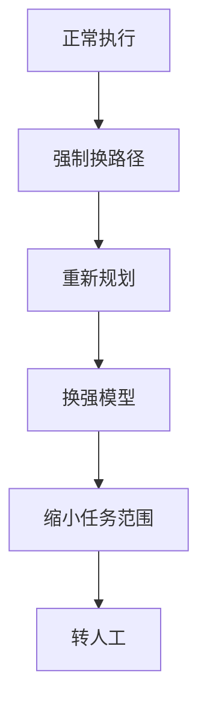

终止条件是 Agent 系统中**防止资源失控的最后一道闸门**。设计良好的终止条件应当是**多重、异构、可归因**的——单一条件（比如"看模型是否说完成了"）几乎必然出问题。

## 终止条件的五大类别

| 类别 | 具体条件 | 关键要点 |
|------|----------|----------|
| **完成类**（成功终止） | 模型给出最终答案；验收条件被程序化校验通过；子任务清单全部标记为已完成 | **优先使用程序化验收而非模型自述**，因为模型经常在没做完时就宣称完成 |
| **预算类**（硬性上限） | 最大步数、最大 token、最大金额、最大墙钟时间、最大工具调用次数 | 必须是**硬上限**，超限即熔断；要能**提前预警**（比如走到 80% 预算时触发降级），而不是撞墙才停 |
| **停滞类**（无进展检测） | 连续 N 步任务状态或环境状态**没有变化**；连续 N 步动作签名重复；工具错误率上升；连续 N 次同类失败 | 防死循环**最有效**的一类 |
| **循环检测** | 对最近 K 步的动作与观测做归一化签名，检测滑窗内的**重复模式**；或用语义相似度识别"签名不同但实质重复"的循环 | 检测到后可**注入引导**（告知已尝试的方案、要求换路径）而不是直接终止 |
| **外部信号** | 用户取消、超时、熔断信号、依赖方不可用 | 独立于 Agent 内部状态的外部干预通道 |

:::tip[程序化验收优先]
完成类终止条件中，**程序化验收**是最可靠的一种，因为它不依赖模型自述。模型经常在没做完时就宣称完成，因此不要只依赖"模型说完成了"这一单一信号。
:::

## 避免死循环的六条策略

### 1. 给每类重复动作设上限

同一工具连续失败 N 次即升级，避免在同一个坑里无限重试。

### 2. 强制多样性

连续两步动作相同时，强制要求换工具或换参数，打破动作层面的单调重复。

### 3. 注入扰动

重复出现时在上下文中写入"已尝试过 X、Y，请换思路"，给模型提供外部引导而非放任其原地打转。

### 4. 重规划降级

从微调参数升级为重新分解任务，再升级为换更大模型，逐级提升解决问题的"火力"。

### 5. 子 Agent 隔离

把可疑任务交给独立的子 Agent 用干净上下文重试，避免污染主上下文，防止错误状态在主线路上扩散。

### 6. 熔断并升级人工

确认无法自动恢复时果断停下并上报，而不是无限重试。人工介入是最后的安全网。

## 降级链：设计重于检测

与其追求"永不循环"，不如设计一条明确的降级链：

**每一级都要有明确的触发阈值**，确保降级不是随机发生，而是可预测、可复现的。

:::tip[触发阈值要明确]
降级链的每一级都必须绑定一个可量化的触发条件（如"连续 3 次同类失败""预算消耗 80%"），否则降级逻辑本身会变成新的不确定性来源。
:::

## 可观测性：终止原因必须可归因

所有终止都要**记录终止原因分类**：成功 / 预算耗尽 / 停滞 / 循环 / 人工取消 / 异常。

这些分类数据是线上分析"Agent 为什么没做完"的**核心依据**。只记"任务失败"是没有诊断价值的——你无法区分是预算不够、陷入循环，还是被用户取消。

:::note[诊断价值]
终止原因分类让每一次失败都可归因，这是后续优化终止条件、调整预算、改进提示词的数据基础。
:::

## 面试怎么答

1. 先讲终止条件为什么必须**多重、异构、可归因**——单一条件（如"看模型是否说完成了"）几乎必然出问题。
2. 再按**完成类、预算类、停滞类、循环检测、外部信号**五类展开，重点强调程序化验收优先和预算硬上限。
3. 接着讲避免死循环的**六条策略**，突出强制多样性、注入扰动和重规划降级这三条最实用的手段。
4. 最后讲**降级链设计和可观测性**，说明终止原因分类是线上诊断的核心依据，只记"任务失败"没有价值。
