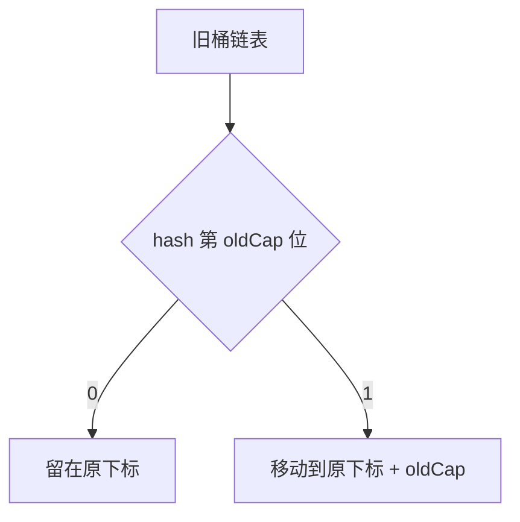

## 扩容触发条件与容量设计

`HashMap` 扩容的触发条件是：当 `size` 超过阈值 `capacity * loadFactor` 时触发，默认负载因子为 **0.75**。

:::note
`new HashMap<>(n)` 传入的 `n` 不是最终容量，而是**预期能存 n 个元素所需的最小容量**。实际容量会被调整到**不小于 n 的最小 2 的幂**（因为扩容要靠位运算定位桶）。默认构造时初始容量是 **16**。
:::

## 扩容倍数为什么必须是 2 的幂

扩容倍数是 **2 倍**：容量从 16 变 32、32 变 64，以此类推。

**必须是 2 的幂**，这样才能用 `hash & (capacity - 1)` 替代取模运算来定位桶，**这是性能的关键**。

## JDK 7 与 JDK 8 扩容方式的根本区别

| 对比维度 | JDK 7 | JDK 8 |
|---------|-------|-------|
| 元素迁移方式 | 重新计算 hash 并迁移到新数组 | 原位置拆分，不需要重新计算 hash |
| 遍历代价 | 遍历每个元素、重新散列，代价高 | 一次遍历完成拆分，高效 |
| 并发问题 | 头插法导致环形链表、丢数据 | 尾插法解决环形链表，但仍可能丢数据 |

## JDK 8 的拆分规律

元素在旧桶中的下标是 `hash & (oldCap - 1)`，扩容后新下标是 `hash & (newCap - 1)`，而 `newCap = oldCap × 2`。

**结论：同一个元素扩容后，要么留在原下标，要么移动到原下标 + oldCap，二者必居其一。**

### 为什么是这样

因为 `newCap - 1 = (oldCap × 2) - 1`，二进制上是 oldCap 的掩码再补一位 1。而 `hash & (oldCap - 1)` 取的是 hash 的低位。

**hash 的第 oldCap 位（那个"新增的高位"）决定了去留**：

- 该位是 **0** → 下标不变
- 该位是 **1** → 下标变为原下标 + oldCap

所以**只需要检查这一位，不需要重新散列**。

### 拆分的具体过程

扩容后每个旧桶会拆成**两个新桶**（lo 和 hi 两条链）：

- 链表中 `hash & oldCap` 为 **0** 的留在原位
- 为 **1** 的移到原位 + oldCap

**JDK 8 用 `loHead`/`loTail` 和 `hiHead`/`hiTail` 四个指针一次遍历完成拆分**，比 JDK 7 的逐个 `put` 重建高效得多。

## 链表与红黑树的转换阈值

| 转换方向 | 触发条件 | 说明 |
|---------|---------|------|
| 链表 → 红黑树 | 链表长度 ≥ 8 且数组容量 ≥ 64 | 容量不足 64 时会**先扩容**（树化需要更大的数组来降低冲突概率） |
| 红黑树 → 链表 | 节点数减少到 6（或加载因子下降） | 中间留了缓冲，避免在阈值附近反复转换 |

:::caution
**树化阈值是 8，退化阈值是 6**，中间留了缓冲区间，防止频繁转换。
:::

## 并发扩容的问题

JDK 8 改用**尾插法**（新节点插到链表尾部）解决了 JDK 7 头插法导致的环形链表死循环问题，但**并发扩容仍然可能导致数据丢失**：两个线程同时扩容，可能一方覆盖另一方迁移的结果。

:::caution
**HashMap 不是线程安全的** —— 它的定位是单线程使用；并发场景请用 `ConcurrentHashMap`。
:::

## 扩容的实际影响

**一是抖动**：`new HashMap<>(n)` 若 `n` 刚好卡在边界上（如 `n=12`，实际容量 16，阈值 12），插入第 13 个就会扩容到 32，浪费一半空间。

:::tip
预估容量时应当传入 `n / 0.75 + 1` 左右，避免扩容抖动。
:::

**二是成本**：扩容是 O(n) 的一次性搬移，**大量预知规模的场景应直接指定合适容量以避免中途扩容**。

## 面试怎么答

1. 触发条件与 2 倍扩容、容量必须为 2 的幂（为了位运算定位桶）
2. JDK 8 的原位置拆分规律（留在原位或移动 oldCap，靠 hash 的第 oldCap 位判断，不需重算 hash）
3. JDK 7 vs 8 的差异（重算 hash vs 拆分；头插环形链表 vs 尾插）+ 树化阈值 8/64/退化 6 + 并发下仍不安全

:::tip
第二点（原位置拆分规律）是区分度最高的地方，面试时重点展开。
:::
