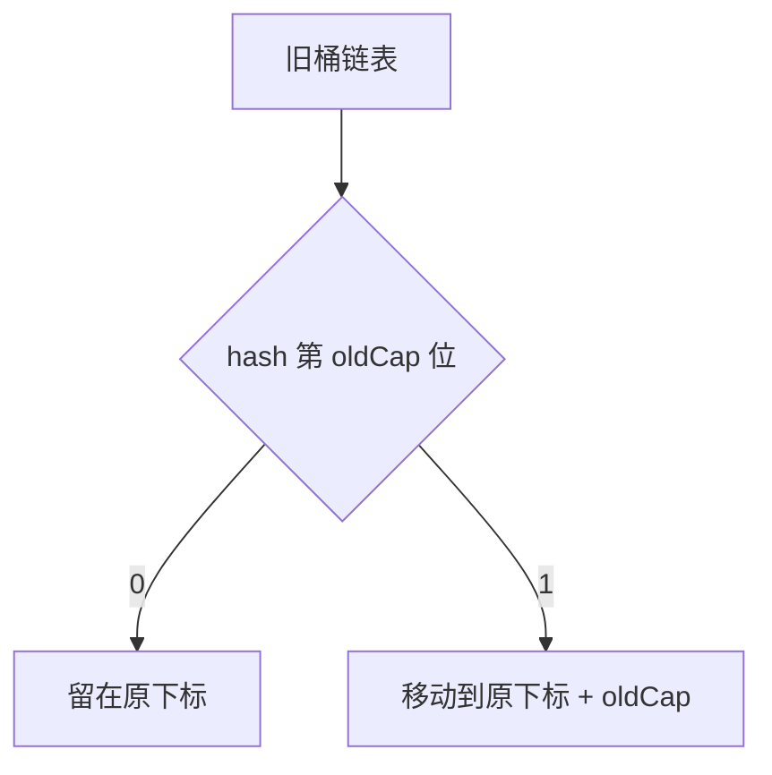

HashMap 的扩容是**容量翻倍并重建数组**：元素个数 `size` 超过阈值 `capacity × loadFactor`（默认负载因子 0.75）时就触发，容量按 2 倍扩展，16 变 32、32 变 64。JDK 8 之后扩容**不重新计算 hash**，只用 `hash & oldCap` 判断去向：该位为 0 的留在原下标，为 1 的移到「原下标 + oldCap」，一次遍历就把旧桶拆成 lo、hi 两条链。

## 触发条件：阈值是容量乘负载因子

扩容只有一个触发点：插入元素后 `size` 超过阈值 `threshold = capacity × loadFactor`。默认负载因子是 **0.75**，所以容量 16 时阈值是 12，插入第 13 个元素就会扩容到 32。

默认构造出来的 `HashMap` 容量是 **16**，第一次 `put` 时才真正分配数组。

`new HashMap<>(n)` 里的 `n` **不是最终容量**，而是「预期能存 n 个元素」所需的容量。构造函数会把容量向上取整到**不小于 n 的最小 2 的幂**（走 `tableSizeFor`），因为后面定位桶要靠位运算。扩容之后阈值也按新容量重算：`newCap × 0.75`。

## 为什么容量必须是 2 的幂

扩容倍数是固定的 **2 倍**：16 → 32 → 64，容量永远保持 2 的幂。

原因只有一条但很关键：**容量是 2 的幂时，`hash & (capacity - 1)` 才等价于 `hash % capacity`**，用一次位与运算取代取模，**这是性能的关键**。而且扩容翻倍后，`capacity - 1` 的二进制只是在高位多出一个 1，掩码依旧是一段连续的全 1，这条性质在扩容后继续成立。

## JDK 7 与 JDK 8 的扩容方式差别

| 对比维度 | JDK 7 | JDK 8 |
| --- | --- | --- |
| 元素迁移方式 | 重新计算 hash，再放进新数组 | 原位置拆分，不需要重新计算 hash |
| 遍历代价 | 遍历每个元素、重新散列，代价高 | 一次遍历完成拆分，高效 |
| 并发问题 | 头插法导致环形链表、丢数据 | 尾插法解决环形链表，但仍可能丢数据 |

差别集中在「元素怎么搬」这一件事上：JDK 7 扩容要遍历旧数组的每个元素、**重新计算下标再放进新数组**；JDK 8 只看 hash 的一位就能决定去向，**一次遍历完成拆分**。

## JDK 8 的拆分规律：只看一位，不重算 hash

元素在旧桶里的下标是 `hash & (oldCap - 1)`，扩容后新下标是 `hash & (newCap - 1)`，而 `newCap = oldCap × 2`。结论很干脆：**同一个元素扩容后，要么留在原下标，要么移动到「原下标 + oldCap」，二者必居其一。**

### 为什么只需检查一位

因为 `newCap - 1 = (oldCap × 2) - 1`，二进制上就是 `oldCap - 1` 的掩码再向左补一位 1。旧下标取的是 hash 的低位，新下标多出来的那一位，正好是 **hash 的第 oldCap 位**（也就是那个新增的高位），它决定了去留：

- 该位是 **0** → 下标不变，留在原位
- 该位是 **1** → 下标变为原下标 + oldCap

所以判断去向只需要做一次 `hash & oldCap`，**不需要重新散列**。

### 拆分的具体过程

扩容后每个旧桶会拆成**两个新桶**（lo 和 hi 两条链）：

- `hash & oldCap` 为 **0** 的元素留在原位，串成 lo 链
- `hash & oldCap` 为 **1** 的元素移到「原下标 + oldCap」，串成 hi 链

JDK 8 用 `loHead` / `loTail` 和 `hiHead` / `hiTail` 四个指针，**一次遍历就把原链表拆成两条**，比 JDK 7 逐个 `put` 重建高效得多。

```java
// JDK 8 HashMap.resize() 里的链表拆分片段（省略红黑树分支）
Node<K,V> loHead = null, loTail = null;
Node<K,V> hiHead = null, hiTail = null;
Node<K,V> next;
do {
    next = e.next;
    if ((e.hash & oldCap) == 0) {        // 该位为 0：留在原下标 j
        if (loTail == null) loHead = e;
        else loTail.next = e;
        loTail = e;
    } else {                             // 该位为 1：移到 j + oldCap
        if (hiTail == null) hiHead = e;
        else hiTail.next = e;
        hiTail = e;
    }
} while ((e = next) != null);
if (loTail != null) { loTail.next = null; newTab[j] = loHead; }
if (hiTail != null) { hiTail.next = null; newTab[j + oldCap] = hiHead; }
```



## 链表与红黑树的转换阈值

树化在插入后判断链表长度，但**容量不够时不会立刻树化**：

| 转换方向 | 触发条件 | 说明 |
| --- | --- | --- |
| 链表 → 红黑树 | 链表长度 ≥ 8 且数组容量 ≥ 64 | 容量不足 64 时会**先扩容**，树化需要更大的数组来降低冲突概率 |
| 红黑树 → 链表 | 节点数减少到 6（删除元素或扩容拆分之后） | 与 8 之间留了缓冲，避免在阈值附近反复转换 |

:::caution
**树化阈值是 8，退化阈值是 6**，中间留了缓冲区间，防止节点数在阈值附近抖动时反复转换。
:::

## 并发扩容：死循环解决了，丢数据没解决

JDK 7 用**头插法**（新节点插在链表头部），并发扩容时两个线程同时搬同一个桶，可能把链表接成环，之后 `get` 命中这个环就会死循环。

JDK 8 改用**尾插法**（新节点插到链表尾部），环形链表导致死循环的问题被解决了，但**并发扩容仍然可能导致数据丢失**：两个线程同时扩容，可能一方覆盖另一方迁移的结果。

:::caution
**HashMap 不是线程安全的**，它的定位是单线程使用；并发场景请用 `ConcurrentHashMap`。
:::

## 扩容的实际影响与容量预估

**一是抖动**：`new HashMap<>(n)` 如果 `n` 刚好卡在边界上，就会白扩一次。例如 `new HashMap<>(12)`，实际容量是 16、阈值是 12，插入第 13 个元素立刻扩容到 32——只多存了一个元素，容量却翻了一倍，多出来的那半边空间是白扩的。

**二是成本**：扩容是 O(n) 的一次性搬移，要新建数组、遍历旧桶、重新挂链。**已知规模的场景应当直接指定合适的容量**，避免中途反复扩容。

:::tip
预估容量时传 `n / 0.75 + 1` 左右，能躲开阈值边界上的那次多余扩容。
:::

## 常见追问

**Q：扩容为什么不能是 1.5 倍？**
A：1.5 倍之后容量不再是 2 的幂，`hash & (capacity - 1)` 就不再等价于取模，只能退回取模运算，扩容时「留原位或后移 oldCap」的一位判断也不成立了。

**Q：拆分后链表顺序会乱吗？**
A：不会。lo、hi 两条链内部都保持原链表的相对顺序（尾插），变的只是元素落在哪个桶。

**Q：为什么树化还要求容量 ≥ 64？**
A：桶太少时冲突多是因为数组小，扩容比树化更划算；容量到 64 以后再冲突，才说明是 hash 本身不够散。

**Q：ConcurrentHashMap 扩容怎么保证并发安全？**
A：它允许其他线程协助迁移（`helpTransfer`），并靠 CAS 与 `synchronized` 锁住单个桶来做迁移，而不是锁整张表。

## 易错点

- **把扩容说成要重新计算 hash。** 重算 hash 是 JDK 7 的做法；JDK 8 的 hash 在 `put` 时就定好了，扩容只用 `hash & oldCap` 判断去向。
- **以为尾插法就等于线程安全。** JDK 8 只解决了环形链表导致的死循环，并发扩容仍可能互相覆盖迁移结果、丢数据，`size` 累加也不是原子操作。
- **以为负载因子越大越省空间就越好。** 0.75 是空间占用和冲突概率的折中，阈值调大会减少扩容次数，但桶内链表更长、查询更慢。
- **以为 `new HashMap<>(n)` 里的 n 就是桶数。** 容量会被向上取整到不小于 n 的最小 2 的幂，而阈值只有容量的 0.75，想装下 n 个元素不扩容就要按 `n / 0.75 + 1` 传。

## 面试时的三句话答法

1. 触发条件是 `size` 超过 `capacity × 0.75`，每次按 2 倍扩容，容量必须是 2 的幂，为的是用 `hash & (capacity - 1)` 这种位运算定位桶。
2. JDK 8 是原位置拆分：元素要么留在原位，要么后移 `oldCap`，靠 hash 的第 oldCap 位判断，全程不重算 hash。**这一点区分度最高，重点展开。**
3. 再补 JDK 7 与 JDK 8 的差异（重算 hash vs 拆分、头插环形链表 vs 尾插）、树化阈值 8 / 容量 64 / 退化 6，以及并发下依然不安全。

## 一句话记住

:::tip
**扩容是数组翻倍；JDK 8 只看 hash 一位：留原位或后移 oldCap。**
:::
