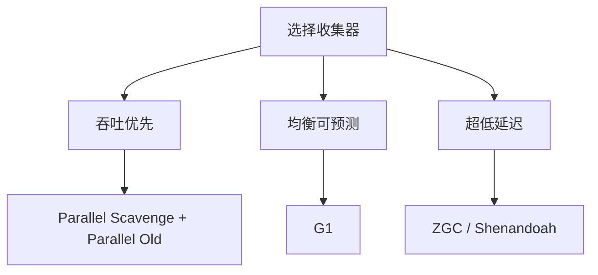

JVM 的内存结构回答「对象分配在哪」：堆是唯一被 GC 重点回收的共享区域，虚拟机栈和程序计数器线程私有，方法区（JDK 8 起由 Metaspace 承接）已搬到本地内存。GC 用可达性分析判定对象死活，再按分代假设分而治之；监控与调优则是先用 GC 日志把问题分型，再决定扩堆、换收集器还是查泄漏。

## 运行时数据区：谁共享、谁被 GC 管

JVM 把内存切成六块，记名字不如记两条分界线：**线程共享还是私有**、**受不受 GC 管理**。这两条决定了内存问题该往哪个方向查。

| 区域 | 线程共享 | 是否受 GC 管理 | 存放内容 | 关键特点 |
|---|---|---|---|---|
| **堆（Heap）** | 是 | **是，唯一被 GC 重点回收的区域** | 几乎所有对象实例与数组 | OOM 最常发生的地方 |
| **虚拟机栈（VM Stack）** | 否 | 否 | 栈帧（局部变量表、操作数栈、动态链接、方法返回地址） | 方法返回即弹出，栈溢出抛 `StackOverflowError` |
| **程序计数器（PC Register）** | 否 | 否 | 当前执行的字节码位置 | 线程私有，唯一不会 OOM 的区域 |
| **本地方法栈** | 否 | 否 | 服务于 Native 方法 | 线程私有 |
| **方法区（Metaspace）** | 是 | 是（类卸载时回收） | 类元信息、运行时常量池、方法数据 | JDK 8 起从堆中独立，用本地内存实现 |
| **直接内存** | — | 否 | NIO 的 `DirectByteBuffer` | 不属于 JVM 规范，不受堆大小限制 |

:::note
**方法区与永久代的关系**：JDK 8 起永久代（PermGen）已被移除，方法区由 **Metaspace** 替代，使用本地内存实现，通过 `-XX:MetaspaceSize` 设初始阈值、`-XX:MaxMetaspaceSize` 设上限。**直接内存**是 OOM 排查时的隐藏坑：它不在 `-Xmx` 的账本里，出问题时报的是 `Direct buffer memory`。
:::

## OOM 的六种形态与对应原因

报错信息本身就在告诉你哪块内存出了事，先读后缀再动手，比盲目加堆有效得多。

| 错误 | 原因 |
|---|---|
| `Java heap space` | 堆不够 —— 内存泄漏、一次性大对象、数据量过大 |
| `GC overhead limit exceeded` | GC 时间占比超阈值（**默认 98%**）仍回收不了多少 —— **通常是内存泄漏** |
| `Metaspace` OOM | 类加载过多（动态代理、脚本、热部署） |
| `Direct buffer memory` | 直接内存耗尽（`DirectByteBuffer` 未及时释放） |
| `unable to create native thread` | 线程数过多、内存不足、或系统层面限制 |
| `StackOverflowError` | 递归过深、栈深度不足（`-Xss` 太小） |

判断口径很简单：带 `heap` 的查堆与分配速率，带 `Metaspace` 的查类加载数量，带 `Direct`/`native` 的说明问题已经跑到 JVM 堆之外了。

## 判定对象已死：可达性分析与对象晋升

Java 用的是**可达性分析**：从 **GC Roots** 出发遍历整张对象图，**不可达即被判定为垃圾**。常见 GC Roots 包括：

- **线程栈（虚拟机栈）中引用的对象** —— 局部变量、方法参数
- **方法区中静态字段引用的对象**
- **方法区中常量引用的对象**（字符串常量池等）
- **JNI 引用**（本地方法栈中引用的对象）

可达性分析的结论是**准确的**（不会误杀活对象），代价是**要暂停所有线程（STW）**才能得到一致的对象图。

:::caution
**可达性分析 ≠ 引用计数**：引用计数实现简单、回收及时，但**无法处理循环引用** —— a 引用 b、b 引用 a，双方计数都不为 0 却都已不可达，于是永远回收不掉。所以 Java 不用它，改用可达性分析。
:::

对象分配不是一进堆就进老年代，而是走晋升路线：Minor GC 后存活的少数对象先被复制到 **Survivor 区**，每熬过一次 Minor GC 年龄加一，达到 `-XX:MaxTenuringThreshold`（HotSpot 默认 15）才**晋升老年代**；大对象则直接进老年代（**大对象阈值**）。Survivor 中同龄对象总和超过一半时，也会触发**动态年龄判定**提前晋升。

:::tip
**老年代回收成本高得多**（Minor GC 是复制几个存活对象，Full GC 要扫描整个堆），所以要尽量让对象在年轻代就死掉。
:::

## 分代假设与三种回收算法

**分代假设**：绝大多数对象都是**朝生夕死**的（放新生代），**少数对象会长期存活**（放老年代）→ 于是**分代收集**，不同区域用不同的算法，各取所长。

| 算法 | 做法 | 代价 |
|---|---|---|
| **复制** | 新生代 `Eden + 2 个 Survivor`（默认 **8:1:1**），Minor GC 时把存活对象**复制**到 Survivor | 要预留空间；**Survivor 不足时对象直接晋升老年代** |
| **标记-清除** | 先**标记**存活对象，再**清除**其余 | 留下内存碎片，大对象可能分配失败 |
| **标记-整理** | 标记后把存活对象向一端移动，再清理边界外内存 | 要移动对象并修正引用，**成本高** |
| **标记-复制** | 标记 + 复制，介于两者之间 | 折中方案 |

新生代选复制算法，是因为存活对象极少：**无需处理死对象、复制后内存连续、分配快**（指针碰撞），代价只是浪费一块 Survivor。

:::caution
**写时复制（COW）不是 GC 算法**，别和新生代的复制算法混着讲。`CopyOnWriteArrayList`、`CopyOnWriteArraySet` 是并发容器：写时复制整个数组、**读操作完全无锁**，适合**读远多于写**的场景。名字里的「复制」只是巧合。
:::

## 垃圾收集器选型

| 收集器 | 默认状态 | 核心特点 | 适用场景 |
|---|---|---|---|
| **Serial** | — | 单线程 | 小应用与客户端 |
| **Parallel Scavenge** | JDK 8 默认 | 多线程**新生代复制 + 老年代标记-整理**，**吞吐优先**，搭配 **Parallel Old** | 批处理、后台计算 |
| **CMS** | **从来不是默认**（JDK 8 常用但可选，JDK 9 废弃，**JDK 14 已移除**） | **低延迟优先**，并发标记，但**碎片多**、**并发模式失败会退化为 Full GC** | 低延迟场景（老系统） |
| **G1** | **JDK 9+ 默认** | **堆划分为 Region**，每个 Region 独立管理（Eden/Survivor/Old 不再物理分区），**可预测的停顿模型**，**支持并发标记** | 兼顾吞吐与延迟，当前主流 |
| **ZGC** | JDK 11 实验引入，**JDK 15 转正**（JDK 21 起提供分代版本） | **超低延迟**（亚毫秒级停顿），**染色指针 + 读屏障**实现并发标记与转移，**停顿时间与堆大小基本无关** | 大堆 + 严苛延迟要求 |
| **Shenandoah** | OpenJDK 提供 | 同样追求超低延迟，**支持压缩指针**（ZGC 早期不支持） | 超低延迟场景 |



选型口诀：**吞吐优先看 Parallel，均衡可预测看 G1，极端延迟看 ZGC / Shenandoah**。换收集器的收益通常远大于在同一收集器上反复调参。

## 关键参数与监控手段

现代 JDK 以 G1 / ZGC 为主，下面这些参数覆盖了绝大多数场景。

| 参数 | 作用 |
|---|---|
| `-Xms` / `-Xmx` | 初始堆 / 最大堆。⭐ **生产环境务必设为相等**，避免运行期反复扩缩 |
| `-XX:MaxGCPauseMillis` | G1 的**目标停顿**（如 200ms），**通过调整年轻代大小来达成** —— **设小会让 GC 更频繁但单次更快** |
| `-XX:G1HeapRegionSize` | G1 Region 大小（默认按堆大小自动推算，1~32MB） |
| `-XX:InitiatingHeapOccupancyPercent`（IHOP） | G1 **何时启动并发标记**（默认 45%） |
| `-XX:MaxTenuringThreshold` | 晋升老年代的年龄阈值（HotSpot 默认 15） |
| `-XX:+UseZGC` | 启用 ZGC |
| `-Xss` | 线程栈大小（影响 StackOverflow） |
| `-XX:MaxMetaspaceSize` | 元空间上限（**不设则无上限，动态类加载易 OOM**） |
| `-XX:+HeapDumpOnOutOfMemoryError` | **OOM 时自动 dump 堆快照** ⭐ 必开 |

其中 `MaxGCPauseMillis` 与 `IHOP` 两者配合决定 G1 的行为，是 **G1 调优的主战场**。

```text
JDK 9+ 统一日志框架（推荐）：
-Xlog:gc*,safepoint:file=gc.log:time,uptime,level,tags:filecount=10,filesize=64M
-XX:+HeapDumpOnOutOfMemoryError -XX:HeapDumpPath=/data/dump

JDK 8 的老写法（参数完全不同，别混用）：
-XX:+PrintGCDetails -XX:+PrintGCDateStamps -Xloggc:gc.log

运行时看各区使用率与 GC 统计：
jstat -gcutil <pid> 1s
```

**基础指标**：`jstat -gcutil <pid> 1s` 看 **S0/S1/E/O/M/CCS** 各区使用率、**YGC/FGC 次数与耗时**、**GCC 时间占比**。**GC 占比超过 5%~10% 就该警惕**，逼近 98% 就是「GC overhead limit exceeded」的前兆。**GC 日志 ⭐ 是最重要的手段**，没有它就只能猜。

| 工具 | 用途 | 关键命令 / 功能 |
|---|---|---|
| **GCViewer** / **GCEasy** | GC 日志可视化分析 | 最易上手 |
| **jstat** | 运行时各区使用率与 GC 统计 | `jstat -gcutil <pid> 1s` |
| **JMC**（Java Mission Control） | 官方可视化工具 | 综合监控 |
| **jcmd** | 运行时诊断 | `jcmd <pid> GC.heap_info`、`Thread.print`、`VM.flags` |
| **jmap** | 堆分析 | `-histo:live` 看对象分布、`dump` 打堆快照 |
| **jstack** | 线程栈 | 排查线程问题 |
| **Arthas** | 生产环境实时诊断 | `dashboard`、`trace`、`profiler`、`thread`、`watch` —— **无需重启** |
| **SkyWalking** / **Pinpoint** / **Elastic APM** | APM 调用链 | 火焰图、慢查询 |

:::caution
**JDK 8 与 JDK 9+ 的日志参数完全不同**（`-Xloggc` 那套在 9 之后已废弃），照抄网上参数前先确认 JDK 版本。
:::

:::tip
**GC 事件与告警**：注册 `NotificationListener` 监听 GC 事件，**停顿时间超过阈值直接告警**，比盯着平均利用率有用得多。
:::

## 调优：先分型，再动手

GC 调优的第一步不是改参数，而是判断属于哪一类问题。四类的现象和处理方式完全不同。

- **内存泄漏（老年代只增不减）**：表现是老年代使用率在 **Full GC 之后也降不下来**。排查流程是 dump 堆快照 → 用 **MAT（Memory Analyzer Tool）** 分析 → 看 **Dominator Tree**（谁支配了最多内存）→ 看 **Leak Suspects** 报告 → 定位到具体对象与持有链。常见泄漏源：**静态集合无限增长**（用 Map 缓存却从不清理）、**监听器未注销**（内部类/匿名类持有外部引用）、**ThreadLocal 未 remove**（线程池复用 → **数据串号 + 内存泄漏**）、**未关闭的连接与流**、**第三方 SDK 内部缓存**。
- **内存不足但无泄漏（瞬时大对象）**：Full GC 后能降下来，但频繁 Full GC。处理方式是**增大堆**、**调小大对象阈值**（`-XX:PretenureSizeThreshold`）、**改用 G1 的 Region 策略**处理大对象、**减少一次性大数组**、**用流式处理替代全量加载**。
- **停顿时间过长（延迟问题）**：**P99 延迟高但平均值正常**。处理方式是**换 G1（默认）或 ZGC（超低延迟）**、**调 `MaxGCPauseMillis`**、**调 IHOP 提前并发标记**、**减少大对象**、**避免频繁 Full GC**。
- **吞吐优先场景**：直接 **Parallel GC + 增大堆**，不必追低延迟。

**调优原则**（比参数表更该背）：

- **优先换收集器，而不是调参数** —— 从 CMS 换 G1、从 G1 换 ZGC 的收益远大于精细调参。
- **调参前必须有监控数据**，**没有 GC 日志就调参 = 盲调**。
- **优先增大堆**：大多数「GC 频繁」其实是**堆太小**，而不是收集器不行。
- **优先减少对象分配**：对象分配速率（Allocation Rate）是 GC 频率的根因。**减少临时对象、避免不必要的大对象、复用对象**比调参更根本。
- **`-Xms` = `-Xmx`**：避免堆动态伸缩带来的抖动。
- **每次只改一个变量**，用**相同负载压测**对比，**看 P99 而不是平均值**。
- **不要迷信「调优参数」** —— 很多「GC 问题」的根因是**代码层面的对象管理问题**（无界缓存、不必要的装箱、大量临时集合）。

排查流程可以照抄：

```
① 看 GC 日志 → 分型：老年代只增不减(泄漏) / 能降但频繁(内存不足) / 停顿长(延迟)
② 泄漏 → dump 堆快照 → MAT → Dominator Tree → 定位持有链 → 修代码
③ 非泄漏 → 扩大堆 + 换 G1/ZGC + 调 MaxGCPauseMillis / IHOP
④ 压测验证 → 对比 P99、GC 占比、分配速率
```

:::tip
四类问题里，**「分型判断」是最能体现实战经验的部分**：同一句「系统卡」，泄漏要修代码，内存不足要扩堆，停顿长要换收集器，方向错了越调越糟。
:::

## 常见追问

**Q：为什么用可达性分析，而不是引用计数？**
A：引用计数无法处理**循环引用**（双方计数都不为 0 却都不可达），且每次赋值都要维护计数；可达性分析从 GC Roots 遍历，天然没有循环引用问题，代价是需要 STW 到安全点。

**Q：Minor GC、Major GC、Full GC 有什么区别？**
A：Minor GC 只清新生代（Eden + Survivor），频繁且停顿短；Major GC 针对老年代；Full GC 清理整个堆并可能带上 Metaspace，停顿最长。G1 里更常见的是 **Mixed GC**，同时回收年轻代与部分老年代 Region。

**Q：为什么要求 `-Xms` 等于 `-Xmx`？**
A：堆动态伸缩时扩容要申请内存、缩容会归还内存，都会带来额外的 GC 与延迟抖动；固定大小让 GC 行为可预测，也避免「堆一直在扩」被监控掩盖。

**Q：`MaxGCPauseMillis` 设得很小是不是更好？**
A：它是**软目标**，G1 通过缩小年轻代、减少每次回收的 Region 数来逼近它，代价是 GC 更频繁、总吞吐下降；设得过小甚至可能触发更多 Full GC。

## 易错点

- **CMS 从来不是 JDK 8 的默认收集器**。JDK 8 默认是 Parallel Scavenge + Parallel Old，CMS 是低延迟场景的可选项，JDK 9 标记废弃、JDK 14 移除。说「JDK 8 默认 CMS」会被一句追问打穿。
- **`-XX:PretenureSizeThreshold` 对 G1 和 Parallel Scavenge 不生效**，它只被 Serial / ParNew 识别；G1 里的大对象走 humongous Region（超过 Region 一半即算），该调的是 `-XX:G1HeapRegionSize`。
- **没有 OOM 不等于内存健康**。GC 占比长期偏高、Full GC 频繁但每次都勉强撑住，同样是故障前兆，`GC overhead limit exceeded` 就是这条路的终点。
- **调 GC 参数治不了内存泄漏**。老年代只增不减时，扩堆只是把 OOM 往后推；必须 dump + MAT 找到持有链改代码。

## 一句话记住

:::tip
堆是 GC 的主战场：泄漏找持有链，不够就扩堆，延迟长就换收集器。
:::
