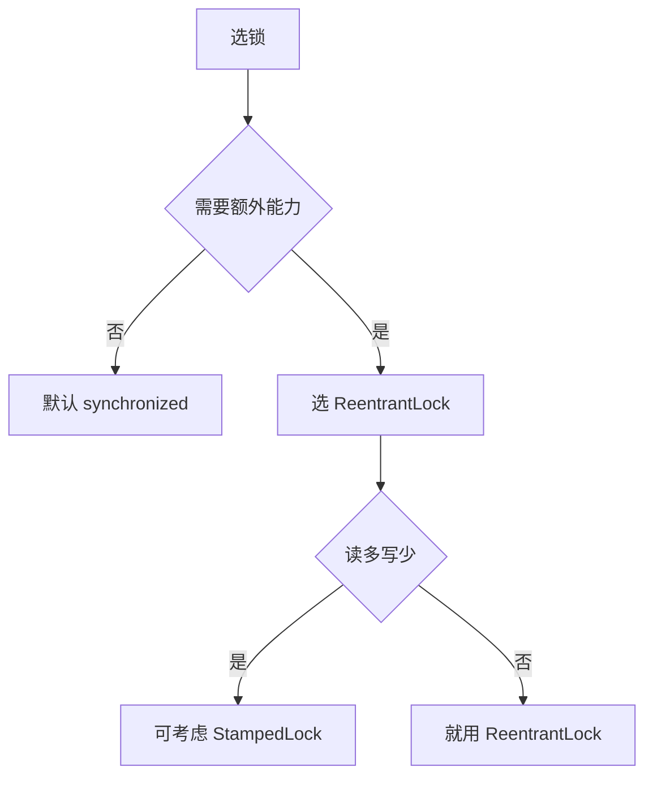

**`synchronized`** 与 **`ReentrantLock`** 都是**互斥锁**，都保证同一时刻只有一个线程进入临界区，且**都是可重入的**（同一线程可重复获取同一把锁）。差异集中在**实现层次、能力边界与使用风险**三个方面。

## 实现层次与释放机制

### 实现层次

`synchronized` 是 **JVM 层面的关键字**——字节码有专门的 `monitorenter` / `monitorexit` 指令，锁的获取与释放由 JVM 完成，线程退出同步块时**自动释放**（包括异常退出）。`ReentrantLock` 是 `java.util.concurrent.locks` 下的一个普通类，基于 **AQS（AbstractQueuedSynchronizer）** 实现，需要**显式调用 `lock()` 与 `unlock()`**。

### 释放时机与最大风险

`synchronized` 由 JVM 保证释放，**绝不会忘记**；`ReentrantLock` 需手动 `unlock()`，**通常要写在 `finally` 块中**——漏写或异常路径未覆盖会直接造成**死锁**。

:::caution[最大的使用风险]
这是 `ReentrantLock` 唯一的、也是最大的使用风险——手动释放必须写在 `finally` 中。
:::

## 能力对比

### 能力对比表

| 维度 | `synchronized` | `ReentrantLock` |
|---|---|---|
| 层级 | JVM 关键字 | JUC 类（AQS） |
| 释放 | **自动**（含异常） | **手动**，须 `finally` |
| 可重入 | ✅ | ✅ |
| 可中断 | ❌ 等待中无法中断 | ✅ `lockInterruptibly()` |
| 超时获取 | ❌ | ✅ `tryLock(timeout)` |
| 公平性 | ❌ 固定非公平 | ✅ 可选公平/非公平 |
| 多条件队列 | ❌ 单个等待集 | ✅ `newCondition()` 多个 |
| 锁类型 | 仅独占 | 独占 + **读写锁** |
| 中断响应（等待） | `wait()` 不可中断 | `Condition.await()` 可中断 |
| 锁状态可观测 | ❌ | ✅ `isLocked()` / `getHoldCount()` / `isFair()` |
| 底层数据结构 | **对象头 Mark Word** | **AQS 的 volatile state + CLH 队列** |

### 公平性

`synchronized` **固定非公平**（竞争时顺序由调度决定，可能刚释放锁的线程被"插队"）。`ReentrantLock` 构造时可传 `true` 使用公平锁，按等待队列 FIFO 获取——**可预期但吞吐更低**，因此**默认仍是非公平**。

### 多条件队列

`synchronized` 只有一个等待集，`notify` 可能唤醒条件不匹配的线程→只能靠 `while` 循环 + `notifyAll` 兜底，**虚假唤醒开销大**。`ReentrantLock` 的 `Condition` **各自独立成队列**，可精确唤醒满足特定条件的线程——`BlockingQueue` 内部正是用 `notFull` / `notEmpty` 两个 Condition 实现的。

## 性能与开销

### 性能要辩证看

**JDK 6 之前** `synchronized` 重量级（阻塞、不可中断、无法超时），`ReentrantLock` 明显更快。**JDK 6 引入偏向锁、后续版本又加入自适应自旋与锁消除**，`synchronized` 的性能差距被大幅缩小。**现代 JVM 上低竞争场景两者接近，`ReentrantLock` 的优势主要来自"额外能力"而非纯速度**。

:::caution[过时认知]
面试时说"`ReentrantLock` 更快"是**过时且不准确的**——现代低竞争场景下 `synchronized` 反而更占优。
:::

### AQS 带来的额外开销

`ReentrantLock` 每次 `lock()` 都要走 AQS 的 `tryAcquire` → 失败则 `addWaiters` 入队 → `acquireQueued` 自旋 + `park`，涉及**更多对象与状态更新**；`synchronized` 由 JVM 用轻量级锁（偏向/轻量级/重量级分级）实现，**无竞争时几乎零开销**。这也是低竞争下 `synchronized` 更占优的原因。

## 组合使用与选型决策

### 可以组合使用

两者**不互斥**——`synchronized` 块内可以调用 `lock()`，`ReentrantLock` 内也可以进 `synchronized` 块。但**同一个对象上混用两种锁机制会导致锁序不一致，反而更容易死锁**。

:::caution[混用风险]
**应避免**在同一个对象上混用两种锁机制。
:::

### 选型决策

- **默认选 `synchronized`**——简洁、不会忘记释放、无需处理中断与超时。
- **需要以下能力时才选 `ReentrantLock`**：**超时获取**（`tryLock`）、**可中断**（`lockInterruptibly`）、**公平性**、**多条件队列**（`Condition`）、**读写锁**（`ReentrantReadWriteLock`）。
- **读写锁本身也可用 `StampedLock`** 替代——支持**乐观读**（读不加锁、先取版本号校验），适合读极多写极少的场景，**但不可重入、不可中断**。

## 面试怎么答

1. **实现层次**：`synchronized` 是关键字 + JVM 自动释放；`ReentrantLock` 是 AQS 类 + 手动释放。
2. **能力边界**：可中断、超时、公平、多条件、读写锁——这五个是 `ReentrantLock` 独有的。
3. **性能要辩证**：JDK 6 后 `synchronized` 差距缩小，别再说"`ReentrantLock` 更快"，现代低竞争场景 `synchronized` 更优。
4. **选型**：默认 `synchronized`，需要额外能力才选 `ReentrantLock`。

:::tip[区分度最高的点]
第三点是区分度最高的——多数人只会说"`ReentrantLock` 性能更好"，能指出这是过时认知会明显不同。
:::
