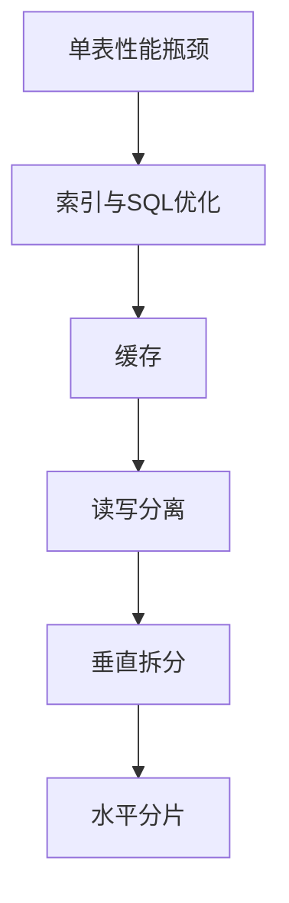

## 什么是分库分表

分库分表是把一份数据**按规则拆分到多个数据库或多个表**中，以突破单库单表的存储与性能上限。拆分的维度有两个：**纵向拆库**（把不同业务/不同数据分到不同库）和**横向拆表**（把同一张表的数据按规则分到多张表），实际方案通常是两者组合。

## 垂直拆分：按业务或字段拆库拆表

### 垂直分库

按业务模块把库拆开，比如用户库、订单库、商品库相互独立。

| 维度 | 说明 |
|------|------|
| 拆分方式 | 按业务模块拆库 |
| 优点 | **业务解耦、故障隔离、可以按业务量独立扩容** |
| 缺点 | 跨库 join 和分布式事务变复杂 |
| 适用场景 | 业务模块边界清晰、模块间访问较少的系统 |

### 垂直分表

把一张字段多、访问场景不同的宽表拆开，比如把用户表的常用字段放主表、低频字段放扩展表。

| 维度 | 说明 |
|------|------|
| 拆分方式 | 按字段访问频率拆表 |
| 优点 | 减少单表字段数，缓解字段访问倾斜 |
| 缺点 | **关联查询需要 join**，扩展表的关联查询要额外处理 |
| 适用场景 | 字段访问倾斜明显的表 |

## 水平拆分：分表与分库

### 水平分表（分片）

同一张表按规则拆成多张物理表，数据总量不变但单表变小。常见规则有四种：

| 分片规则 | 路由方式 | 优点 | 缺点 | 适用场景 |
|----------|----------|------|------|----------|
| 取模分片 | 按 `user_id % N` 路由 | 分布均匀 | **扩容需要迁移大量数据** | 数据量稳定、扩容需求少的场景 |
| 范围分片 | 按时间或 ID 区间分片 | **扩容只需新增一张表** | 容易数据倾斜 | 时间序列数据、写入量持续增长 |
| 一致性哈希 | 虚拟节点分片 | 扩容时只需迁移部分数据 | 实现复杂 | 许多分片中间件的默认方案 |
| 基因分片 | 把分片键的一部分编码进其他字段 | 解决**跨分片查询**问题 | 需要额外编码逻辑 | 非分片键查询频繁的场景 |

适合单表数据量过大、查询能带上分片键的场景。

### 水平分库

同一张表按规则拆到不同数据库实例上。

| 维度 | 说明 |
|------|------|
| 拆分方式 | 按规则路由到不同库实例 |
| 优点 | 突破了**单机的存储与连接数上限**，可跨机扩展吞吐，是"分库"的核心价值 |
| 缺点 | 跨库事务与跨库 join 难度大 |
| 适用场景 | 单库连接数或存储成为瓶颈时 |

## 分片后的核心挑战

### 分布式 ID

分片后不能再依赖数据库自增，需要引入**全局唯一 ID 方案**：

| 方案 | 特点 | 注意事项 |
|------|------|----------|
| 数据库号段模式 | 发号器批量取号，兼顾性能与数据库压力 | 需要维护发号器表 |
| 雪花算法 | 时间戳加机器号加序列号，趋势递增、分布式生成 | 要注意**时钟回拨**和机器号冲突 |
| 美团 Leaf | 号段模式与雪花算法的工程化实现 | 依赖 ZooKeeper 等协调组件 |
| Redis 自增 | 利用 Redis 原子自增生成 ID | 依赖 Redis 可用性 |
| UUID | 无序，不适合做聚簇索引主键 | 生成简单但性能差 |

### 分片键选择决定成败

必须选**查询最高频的维度**作为分片键，否则大量查询会变成全分片扫描。

:::tip[面试加分点]
分片键要尽量**避免跨分片查询与跨分片排序**，否则要引入多分片归并，或者做**异构索引库**（建一张映射表把非分片键查询路由到分片）。
:::

### 分页与排序是重灾区

跨分片的 `LIMIT` 需要各分片取全量再归并排序，深分页性能极差。

:::caution[易错点]
深分页在分片环境下性能急剧恶化，不能直接沿用单库的 `LIMIT offset, size` 写法。
:::

解决方案有三种：

| 方案 | 思路 | 适用场景 |
|------|------|----------|
| **二次查询法** | 第一次只查 id，内存归并后再批量回表 | 深分页且排序字段稳定 |
| **游标方式** | 记录上一页最后一条的排序值 | 滚动加载、无限滚动场景 |
| **搜索引擎** | 用 ES 做二级索引 | 复杂条件查询、全文检索 |

## 分布式事务

跨库写需要处理一致性问题，方案包括：

| 方案 | 一致性 | 性能 | 业务侵入 | 适用场景 |
|------|--------|------|----------|----------|
| **两阶段提交（2PC）** | 强一致 | 差、阻塞 | 低 | 对一致性要求极高的短事务 |
| **TCC** | 最终一致 | 较好 | 大（Try-Confirm-Cancel） | 需要手动控制补偿逻辑 |
| **可靠消息最终一致** | 最终一致 | 好 | 小（本地消息表或 RocketMQ 事务消息） | **最常用**、异步解耦场景 |
| **Seata 等框架** | 视模式而定 | 较好 | 中（封装 AT/TCC 模式） | 微服务架构 |

:::note[实践建议]
实践中通常用**最终一致 + 对账补偿**替代强一致，以换取可用性与性能。
:::

## 什么时候该上分库分表

不要过早分片。优先顺序是：**索引与 SQL 优化 → 缓存 → 读写分离 → 垂直拆分 → 最后才是水平分片**。

单表超过千万级且写入量确实成为瓶颈、且已经无法通过以上手段解决时再考虑。

## 中间件与代价

常见方案有：

| 方案 | 层级 | 特点 |
|------|------|------|
| ShardingSphere | 应用层 | 侵入小，需在应用内配置分片规则 |
| Mycat | 代理层 | 对应用透明，但增加网络跳数 |
| 云厂商分布式数据库 | 基础设施 | 屏蔽分片细节、支持弹性扩容 |

:::caution[代价与风险]
分片带来的代价是**复杂度大幅上升** —— 跨片查询、分布式事务、全局 ID、扩容迁移、运维排查都要重新设计，并且**扩容期间的在线数据迁移本身就是一场大工程**。
:::
