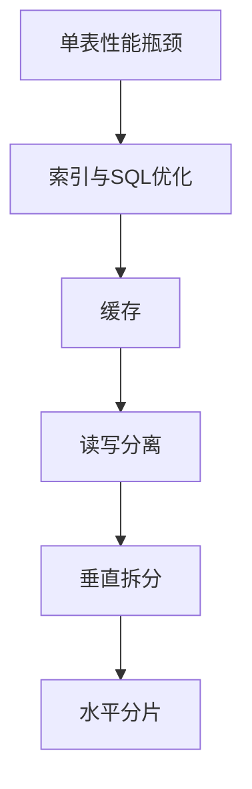

分库分表是把一份数据**按规则拆分到多个数据库或多个表**中，用来突破单机在存储容量、连接数和写入吞吐上的上限。拆分只有两个方向：按业务模块或字段访问频率切开的**垂直拆分**，以及按同一套规则把行数据打散的**水平拆分**，真实方案基本都是两者的组合。代价同样明确：跨片查询、分布式事务、全局唯一 ID 和在线扩容迁移，都得重新设计一遍。

## 拆分只有两个维度：垂直切形状，水平切行数

垂直拆分按业务和字段切：垂直分库按业务模块拆库，垂直分表按字段的访问频率拆表，拆完每个库、每张表的结构都不一样。水平拆分按行切：表结构保持不变，把数据按规则分发到多张物理表或多台实例上，所以表结构完全一致、只是数据被分走了。

| 类型 | 切分依据 | 拆完的结果 |
| --- | --- | --- |
| 垂直分库 | 业务模块 | 用户库、订单库、商品库相互独立 |
| 垂直分表 | 字段访问频率 | 主表放高频字段，扩展表放低频大字段 |
| 水平分表 | 行 + 分片规则 | 一张表变成多张结构相同的物理表 |
| 水平分库 | 行 + 分片规则 | 同一张表的数据落到多个数据库实例 |

一句话区分：**垂直拆的是库和表的形状，水平拆的是数据的行数**。垂直拆分改动小、通常先做；水平拆分才是真正把单表数据量和单机负载降下来的那一步，也是复杂度暴涨的来源。

## 垂直拆分：按业务拆库，按字段拆表

### 垂直分库

按业务模块把库拆开，比如用户库、订单库、商品库相互独立，各自有独立的连接池和存储。

| 维度 | 说明 |
| --- | --- |
| 拆分方式 | 按业务模块拆库 |
| 优点 | **业务解耦、故障隔离、可以按业务量独立扩容** |
| 缺点 | 跨库 join 和分布式事务变复杂 |
| 适用场景 | 业务模块边界清晰、模块之间访问较少的系统 |

### 垂直分表

把一张字段多、访问场景差异大的宽表拆开，比如用户表的常用字段放主表，个人简介、头像这类低频大字段放扩展表，主表行更短、一页能装更多行，热点查询更快。

| 维度 | 说明 |
| --- | --- |
| 拆分方式 | 按字段访问频率拆表 |
| 优点 | 减少单表字段数，缓解字段访问倾斜 |
| 缺点 | **关联查询需要 join**，扩展表的关联查询要额外处理 |
| 适用场景 | 字段访问倾斜明显的表 |

两种垂直拆分的共同前提是边界真的清楚：垂直分库后原本一条 SQL 就能 join 出来的数据，现在要跨库取；垂直分表后查完整对象必须按主键再把扩展表捞一次。边界不清就拆，等于把单库的麻烦换成了分布式的麻烦，收益却不出现。

## 水平拆分：分表解决数据量，分库解决单机上限

### 水平分表（分片）

同一张表按规则拆成多张物理表，**数据总量不变，但单表变小**，索引更浅、单表维护成本更低。常见规则有四种：

| 分片规则 | 路由方式 | 优点 | 缺点 | 适用场景 |
| --- | --- | --- | --- | --- |
| 取模分片 | 按 `user_id % N` 路由 | 分布均匀 | **扩容需要迁移大量数据** | 数据量稳定、扩容需求少的场景 |
| 范围分片 | 按时间或 ID 区间分片 | **扩容只需新增一张表** | 容易数据倾斜 | 时间序列数据、写入量持续增长 |
| 一致性哈希 | 虚拟节点分片 | 扩容时只需迁移部分数据 | 实现复杂 | 一些分片中间件把它作为默认方案 |
| 基因分片 | 把分片键的一部分编码进其他字段 | 解决**跨分片查询**问题 | 需要额外编码逻辑 | 非分片键查询频繁的场景 |

取模和范围的取舍最典型：取模把数据摊得最均匀，但分片数一改，几乎每条数据的分片位置都要重算，扩容基本等于一次全量迁移；范围分片扩容时只要往后追加一张新表，代价极低，但写入永远落在最新区间，热点和倾斜也都集中在那里。一致性哈希用虚拟节点缓解倾斜，扩容只影响相邻的一段数据，代价是实现和维护更复杂。基因分片则是把分片键的一部分编码进另一个字段，让按订单号这类非分片键的查询也能直接算出分片位置。

分片键有没有出现在查询条件里，落地差异极大：

```sql
-- 分片键是 user_id，带分片键的查询只落一个分片
SELECT * FROM t_order WHERE user_id = 42 AND status = 1;   -- 只查 t_order_2

-- 不带分片键，只能每个分片都查一遍再归并
SELECT * FROM t_order WHERE status = 1;
```

适合水平分表的场景是单表数据量过大，而且主要查询都能带上分片键。

### 水平分库

同一张表按规则拆到不同数据库实例上，表结构不变，变的是数据落在哪个库。

| 维度 | 说明 |
| --- | --- |
| 拆分方式 | 按规则路由到不同库实例 |
| 优点 | 突破了**单机的存储与连接数上限**，可跨机扩展吞吐，这是"分库"的核心价值 |
| 缺点 | 跨库事务与跨库 join 难度大 |
| 适用场景 | 单库连接数或存储成为瓶颈时 |

分表和分库经常一起用：先按分片键把数据分到 N 个库，每个库内部再分 M 张表，总共 N×M 个分片。分表解决的是"单表太大"，分库解决的是"单机扛不住"，两个瓶颈得分开判断。

## 分片之后要立刻处理的三个硬问题

### 全局唯一 ID

分片后不能再依赖单库自增，需要引入**全局唯一 ID 方案**：

| 方案 | 特点 | 注意事项 |
| --- | --- | --- |
| 数据库号段模式 | 发号器批量取号，兼顾性能与数据库压力 | 需要维护发号器表 |
| 雪花算法 | 时间戳加机器号加序列号，趋势递增、分布式生成 | 要注意**时钟回拨**和机器号冲突 |
| 美团 Leaf | 号段模式与雪花算法的工程化实现 | 依赖 ZooKeeper 等协调组件 |
| Redis 自增 | 利用 Redis 原子自增生成 ID | 依赖 Redis 可用性 |
| UUID | 无序，不适合做聚簇索引主键 | 生成简单但性能差 |

选型的核心是两件事：ID 是否**趋势递增**，以及发号服务本身能不能扛住和数据库同等级别的可用性要求。无序 ID 当聚簇索引主键会让插入随机落在页中间，频繁页分裂，这也是 UUID 被排除的主要原因。

### 分片键选错，全盘皆输

必须选**查询最高频的维度**作为分片键，否则大量查询不带分片键，会退化成全分片扫描：请求量被放大到与分片数同一量级，归并结果还要额外占用内存和排序开销。

:::tip[面试加分点]
分片键要尽量**避免跨分片查询与跨分片排序**，否则要引入多分片归并，或者做**异构索引库**（建一张映射表，把非分片键查询路由到对应分片）。
:::

### 跨分片分页与排序是重灾区

跨分片的 `LIMIT` 没法只取前几条：每个分片都得先取出 `offset + size` 条，汇总后再归并排序，深分页时每个分片都要扫大量数据，性能急剧恶化。

:::caution[易错点]
深分页在分片环境下性能急剧恶化，不能直接沿用单库的 `LIMIT offset, size` 写法。
:::

常见解法有三种：

| 方案 | 思路 | 适用场景 |
| --- | --- | --- |
| **二次查询法** | 第一次只查 id，内存归并后再批量回表 | 深分页且排序字段稳定 |
| **游标方式** | 记录上一页最后一条的排序值 | 滚动加载、无限滚动场景 |
| **搜索引擎** | 用 ES 做二级索引 | 复杂条件查询、全文检索 |

## 跨库写的一致性：分布式事务怎么选

一个业务操作落到多个库，本地事务就失效了，需要显式处理一致性：

| 方案 | 一致性 | 性能 | 业务侵入 | 适用场景 |
| --- | --- | --- | --- | --- |
| **两阶段提交（2PC）** | 强一致 | 差、阻塞 | 低 | 对一致性要求极高的短事务 |
| **TCC** | 最终一致 | 较好 | 大（Try-Confirm-Cancel） | 需要手动控制补偿逻辑 |
| **可靠消息最终一致** | 最终一致 | 好 | 小（本地消息表或 RocketMQ 事务消息） | **最常用**、异步解耦场景 |
| **Seata 等框架** | 视模式而定 | 较好 | 中（封装 AT/TCC 模式） | 微服务架构 |

:::note[实践建议]
实践中通常用**最终一致 + 对账补偿**替代强一致，以换取可用性与性能。
:::

选择时先问一句"这笔不一致能不能靠事后补偿兜住"。能兜住的（下单加积分、发通知）就走可靠消息，简单又不阻塞；兜不住又必须强一致的短操作才考虑 2PC，但要接受它的同步阻塞代价。TCC 适合金额、库存这类必须自己写补偿逻辑的核心链路，代价是三套接口都要实现幂等和空回滚处理。

## 什么时候才该上分库分表

不要过早分片。优先顺序是：**索引与 SQL 优化 → 缓存 → 读写分离 → 垂直拆分 → 最后才是水平分片**。

1. 先看慢查询和索引，很多"表太大"其实是缺索引或写法问题；
2. 再加缓存，把读压力从数据库前面挡掉；
3. 然后读写分离，把读流量分摊到从库；
4. 接着做垂直拆分，按业务和字段先瘦身；
5. 以上都无效，才做水平分片。



判断时机时看两个条件是否同时成立：一是单表数据量到了千万级、单表维护和查询明显变慢；二是写入量或连接数确实成了瓶颈，并且前面几步都已经做过。只满足一个就动手，往往付出分布式复杂度却换不到多少收益。

## 中间件选型与分片的真实代价

| 方案 | 层级 | 特点 |
| --- | --- | --- |
| ShardingSphere | 应用层 | 侵入小，需在应用内配置分片规则 |
| Mycat | 代理层 | 对应用透明，但增加网络跳数 |
| 云厂商分布式数据库 | 基础设施 | 屏蔽分片细节、支持弹性扩容 |

:::caution[代价与风险]
分片带来的代价是**复杂度大幅上升**：跨片查询、分布式事务、全局 ID、扩容迁移、运维排查都要重新设计，并且**扩容期间的在线数据迁移本身就是一场大工程**。
:::

应用层方案的 SQL 能力受中间件实现约束，代理层方案多一跳网络但应用改动小，云上方案把迁移和扩容交给厂商，代价是绑定与成本。选型前先算清楚：分片规则以后会不会变，变的时候谁来迁数据。

## 常见追问

**Q：分库和分表是一回事吗？**
A：不是。分表解决单表数据量大导致的索引变深、查询变慢；分库解决单机存储、连接数和写入吞吐的上限。数据量大的系统通常先分表，再按分片键把表分布到多个库。

**Q：为什么不能直接上分片，非要先做优化和缓存？**
A：分片是一次不可逆的架构升级，会引入跨片查询、分布式事务、全局 ID、扩容迁移等一整套问题。索引、SQL 优化、缓存、读写分离这些手段成本低得多，很多时候做完瓶颈就消失了。

**Q：分片键一定要用主键吗？**
A：不一定，但要用**查询最高频的维度**，通常是 user_id、tenant_id 这类业务维度。用非主键做分片键时，主键就得配合基因法把分片信息编码进去，否则按主键查也无法定位分片。

**Q：分片后跨分片查询怎么做才好？**
A：三条路：把分片键补进查询条件（最优先）、建异构索引库把非分片键映射到分片、或者用 ES 这类搜索引擎承接复杂条件查询。实在都不行，才做多分片归并。

## 易错点

- **把垂直拆分当成解决数据量的手段**：垂直拆分只是按业务和字段把库表切小，总行数没变，单表数据量大的问题它解决不了，那要靠水平分片。
- **以为取模分片扩容只是加机器**：分片数一变，几乎所有数据的分片位置都要重算，必须做数据迁移甚至双写切换，这是取模最大的代价。
- **拿单库的深分页写法照搬**：分片下 `LIMIT offset, size` 会让每个分片都取 `offset + size` 条再归并，offset 越大越慢，应该改用游标或二次查询。
- **以为分片后就一定能扛住高并发**：分片解决的是单机存储与连接数上限，跨片查询、跨片事务、归并排序这些新成本反而可能把吞吐吃掉，容量规划要按分片后的真实链路重算。

## 一句话记住

:::tip
分库分表是把数据按规则拆散以突破单机上限，垂直拆形状、水平拆行数，代价是跨片查询与分布式事务。
:::
