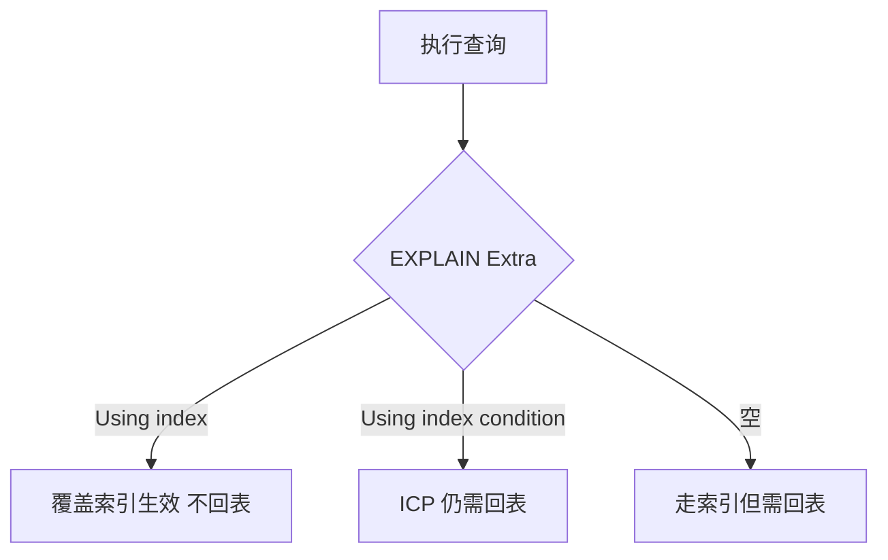

覆盖索引是指：**查询语句需要的所有字段，都恰好包含在某一个索引中**，因此**只需扫描索引即可拿到全部数据，无需回表**。它的判断标准只有一条：**看 `EXPLAIN` 的 `Extra` 里是否出现 `Using index`。** 能命中要三个条件同时满足：单表查询、`WHERE`/`SELECT`/`ORDER BY` 涉及的所有列都在索引里、并且优化器实际走的就是那个索引。

## 覆盖索引的判定标准

**核心判定**：`EXPLAIN` 的 `Extra` 列出现 `Using index` → 覆盖索引生效，没有回表。

**⚠️ 注意区分 `Using index` 与 `Using index condition`**：

| `Extra` 值 | 含义 | 是否回表 |
|---|---|---|
| `Using index` | 覆盖索引生效 | 否 |
| `Using index condition` | 索引条件下推（ICP），在索引上过滤条件 | 是 |
| 空 | 走索引但需回表 | 是 |

:::tip
**这两个经常被混淆。`Using index condition` 不代表覆盖索引。**
:::



## 为什么覆盖索引快（底层原因）

- **索引的叶子节点只存"索引列 + 主键值"** → **体积远小于聚簇索引的整行数据**
- 扫描索引 = **顺序 IO**、**页更少**、**缓冲池命中率更高**
- **完全不回表 = 零随机 IO**

:::tip
**这是"覆盖索引"成为最重要的索引优化手段的根本原因。**
:::

## 覆盖索引的命中条件

三个条件**同时满足**：

| 条件 | 说明 |
|---|---|
| ① 只有一个表 | 多表 JOIN 时，除非索引里包含了关联表的字段，否则必然回表 |
| ② 查询涉及的字段全部在索引中 | `WHERE` 条件列 + `SELECT` 列 + `ORDER BY` 列 |
| ③ 走的正是那个索引 | `EXPLAIN` 的 `key` 字段要指向它 |

## 最左前缀对覆盖索引的影响

```sql
-- 索引 (a, b, c)
SELECT a, b, c FROM t WHERE a = ?;            -- ✅ Using index
SELECT a, b, c FROM t WHERE a = ? AND b = ?;   -- ✅ Using index
SELECT a, b, c FROM t WHERE a = ? AND c = ?;   -- ❌ b 断链 → c 无法定位 → 回表
SELECT b, c    FROM t WHERE a = ?;            -- ⚠️ 只有 a, b, c 在索引里但 b 断链 → 回表
```

:::caution
**关键区分**：**"某列能否用于定位"** 与 **"某列是否在索引里"** 是两件事。**即使某列因最左前缀失效而不能用于定位，它仍然在索引中**，因此依然能覆盖。
例：索引 `(a, b, c)`，查询 `WHERE a=? AND c=?` → `c` 不能定位，但 `c` 在索引里 → **仍可覆盖，不回表**。
:::

## 覆盖索引的设计方法

**把高频查询的 `SELECT` 列，追加到联合索引的末尾**。追加在末尾而不是插在中间：插到中间会让原来的 `age` 失去最左前缀的定位能力，已有查询反而变差；放在末尾则原有前缀保持不变，只是多带了一列数据。

```sql
-- 原索引
KEY idx_user (name, age)
-- 高频查询：SELECT name, age, email FROM user WHERE name = ?
-- 改为
KEY idx_user (name, age, email)   -- email 追加在末尾 → 覆盖该查询
```

:::caution
**⚠️ 代价**：索引变大 → 写入变慢、占用空间增加。**不要为了覆盖索引把大字段（TEXT、长 VARCHAR）塞进索引。**
:::

## 覆盖索引的典型场景与限制

### 典型场景

- **列表页**：只查 `id + 几个展示字段` → 追加到主键索引后 → **分页查询零回表**
- **计数与存在性判断**：`SELECT COUNT(*) FROM t WHERE idx_col = ?` → 只用索引即可
- **带 JOIN 的分页**：JOIN 表的字段无法在主表索引里 → 必然回表

### 三个限制

- **⚠️ JOIN 的另一张表的字段无法覆盖** → 除非用**冗余字段**或**宽表**
- **⚠️ `SELECT *` 永远无法覆盖**（除表只有索引列的情况）→ **规范：不要写 `SELECT *`**
- **⚠️ 需要回表拿大字段时，覆盖索引反而更慢**（索引更大 + 仍要回表）

### 怎么验证是否命中

```
EXPLAIN SELECT ... ;   -- 看 Extra 列
  Using index            → 覆盖索引生效
  Using index condition  → 只是 ICP，仍回表
  (空)                   → 走索引但需回表
```

**更精确的验证法**：把 `SELECT` 列改成索引里的列，再看 `Extra` 是否变成 `Using index`。

## 易错点

- **错**：`Extra` 里只要出现 `index` 字样，就算覆盖索引命中。**对**：只有 `Using index` 才算；`Using index condition` 是索引条件下推，过滤完仍要回表取整行。
- **错**：某列被最左前缀断链，就覆盖不了了。**对**：能否用于定位、是否存在于索引里是两件事，值仍在索引叶子节点上，`SELECT` 只要不超出索引列，就照样不用回表。
- **错**：覆盖索引只有好处，能覆盖就尽量全覆盖。**对**：索引变宽会让写入变慢、空间变大，把 TEXT、长 VARCHAR 塞进索引往往得不偿失，需要回表取大字段时甚至更慢。
- **错**：多表 JOIN 也能靠给主表加索引做到零回表。**对**：主表索引里没有关联表的字段，除非做冗余字段或宽表，否则 JOIN 必然要回表。

## 常见追问

**问：面试官问「覆盖索引为什么快」，你按什么顺序答才不算漏？**
**答：** 先给定义与判定（所有字段都在索引里 → 只扫索引；用 `EXPLAIN` 的 `Using index` 验证，并区分 `Using index condition` 只是 ICP），再讲快的根因（索引体积小 + 顺序 IO + 零回表随机 IO），最后落到设计方法：把高频 `SELECT` 列追加到联合索引末尾。

**问：`Using index condition` 到底和覆盖索引差在哪？**
**答：** 它是索引条件下推：`WHERE` 里的列在索引上先做过滤，减少回表次数，但 `SELECT` 的列不在索引里，过滤后每条命中记录仍要回表取整行，所以 `Extra` 报的是 condition 而不是 `Using index`。

**问：最左前缀断链了，`SELECT` 这几列还能覆盖吗？**
**答：** 能。断链只是让这一列无法用于定位，它的值仍然存在索引叶子节点上；索引 `(a,b,c)` 下 `WHERE a=? AND c=?` 查 `a,b,c` 仍可覆盖，只是要用 `a` 定位后在这批记录里逐条比对 `c`。

**问：那把所有 `SELECT` 列都追加进索引，是不是越宽越好？**
**答：** 不是。索引变宽直接推高写入成本和空间占用，大字段（TEXT、长 VARCHAR）尤其不划算；而且 `SELECT *` 永远无法覆盖（除非表只有索引列），所以规范上要求不写 `SELECT *`，只取真正需要的列。

## 一句话记住

:::tip
SELECT 列全在索引里、`Extra` 出现 `Using index`，才算覆盖索引。
:::
