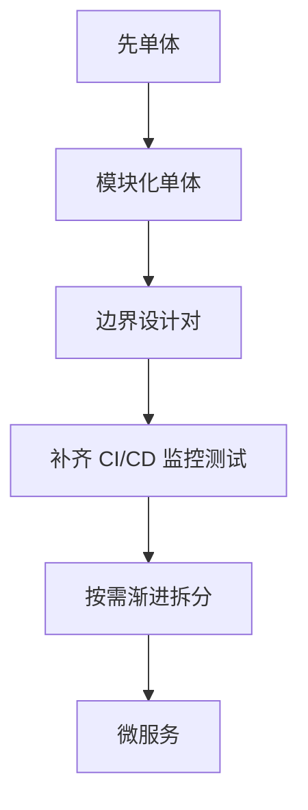

微服务是一种架构风格：把一个应用按业务能力拆成若干独立部署、独立演进、通过网络通信协作的小服务，每个服务拥有自己的数据存储与发布节奏。它和单体的本质区别不在代码分成几块，而在能否独立部署、独立扩容——判断边界看部署单元，不看目录结构。它优化的是组织与交付效率，不是性能，代价是分布式复杂度。

## 它到底是什么：边界在部署单元，不在目录结构

微服务在技术上几乎没有新东西，全是已有技术的组合：HTTP 或 RPC 做进程间调用，消息队列做异步解耦，服务注册发现做寻址，容器与编排做部署，网关做统一入口与鉴权限流。它的「新」在切分方式与随之而来的组织约束上。

真正的分界线是部署单元边界。一个把 Controller、Service、DAO 分成三个模块、但只能一起打包发版的巨型工程，仍然是单体；只有当这三部分能各自打包、各自发布、各自扩容、各自拥有独立数据时，才具备微服务的特征。

:::tip[判断标准]
边界看部署单元：能各自发版、各自扩容、各自拥有数据，才叫微服务；代码目录怎么分不算数。
:::

## 核心特征：五条要同时成立

| 特征 | 说明 |
|------|------|
| 按业务能力划分 | 不是按 Controller/Service/DAO 技术分层 |
| 独立部署 | 每个服务一个部署单元，可单独发版 |
| 独立数据 | 每个服务拥有自己的数据存储，不共享数据库 |
| 松耦合通信 | 服务间只通过接口契约交互 |
| 可观测与治理 | 统一日志、链路追踪、配置中心、服务发现 |

这五条里前三条是硬条件，后两条是能长期跑下去的前提。其中「独立数据」值得单独强调：数据一旦跨服务共享，服务边界就只剩形式，改一处表结构仍然要开跨团队协调会。

:::warning[注意]
共用一套库是最贵的省事：省下的是建库成本，赔进去的是拆分本身的意义。
:::

## 要解决的问题：协作与交付效率，不是性能

微服务要解决的是「组织与交付效率」。当单体膨胀到几十个团队共改一个仓库、每次发版要回归全量、某个热点模块被迫和整个系统一起扩容时，微服务把耦合点从编译期移到运行期：团队之间只依赖接口契约，不再依赖同一份代码，于是能并行开发、独立发布、独立扩容。

这也解释了它的取舍——拆开之后，一次进程内方法调用变成了可能失败的网络调用，明明是为组织效率付的账，却被写在了技术账单上。

:::note
它优化的是协作与交付，不是性能。单看单次请求延迟，微服务通常比同等功能的单体更慢。
:::

## 什么时候该用，什么时候不该用

### 什么时候该用

| 条件 | 说明 |
|------|------|
| 团队规模需要独立交付 | 多团队共改单体，每次发版互相阻塞 |
| 伸缩需求差异巨大 | 某模块 IO 密集需大量实例，另一模块计算密集 |
| 业务边界清晰 | 能划分出边界明确、职责单一的领域 |
| 独立发布节奏诉求 | 某些模块需要高频迭代、另一些追求稳定 |
| 具备分布式运维能力 | 有 CI/CD、服务治理、监控、故障处理的基础设施与人才 |

### 什么时候不该用

| 条件 | 说明 |
|------|------|
| 团队很小或人员不成熟 | 3~10 人的团队做微服务，运维成本会压垮收益 |
| 业务边界还不清晰 | 边界没理清就拆，只会造出「分布式单体」 |
| 规模还小 | 单体足以支撑当前业务量 |
| 缺少基础设施 | 没有 CI/CD、监控、链路追踪、容器编排，拆开只会更糟 |
| 强事务一致性要求很高 | 跨服务强一致需要分布式事务，复杂度陡增 |

判断时先看「团队是否被同一个发布窗口卡住」，这通常比看业务量更准。团队只有一个、发版不用排期，那微服务带来的收益基本是零，而复杂度是实打实的。

## 失败模式与拆分原则：分布式单体

微服务实践中最普遍的翻车形态是「分布式单体」：服务拆开了，但接口之间调用密集、数据仍共享同一套库、发布仍需协调，结果是同时承担了分布式的复杂度和单体的耦合——比单体更糟。根因是拆分维度错了，比如按技术分层拆（拆出一个「用户服务」还顺手拆出一个「查询服务」），或者按「太难写所以拆出去」拆，而不是按业务能力拆。

拆分的关键是「按业务能力 + 限界上下文」。理想的服务边界应当是业务上内聚、技术上自治的。判断边界是否合理，有两个实用标准：

- 这个服务能否在不与其他服务协商的情况下独立演进、独立发版
- 能否独立地决定自己的数据模型，而不需要别的服务跟着改

如果两条里有一条做不到，说明边界切错了：要么该合回去，要么该往下拆。这两条也是「分布式单体」最早暴露出来的症状。

## 代价与务实路径：模块化单体起步

| 代价 | 说明 |
|------|------|
| 分布式复杂度 | 网络不可靠、部分失败、分布式事务、最终一致、时钟不一致、幂等 |
| 可观测性成本上升 | 一次请求跨 N 个服务，没有链路追踪根本排查不了 |
| 测试成本上升 | 要测服务间契约、要做集成测试与契约测试 |
| 部署运维复杂度 | 几十个服务要独立发布、滚动升级、灰度、回滚 |
| 延迟累加 | 网络跳数增加 |

这些是必须付的代价，不是可以忽略的细节；任何一个没有对应手段，拆分都会立刻反噬。所以务实的路径是倒过来走：

先单体，把边界设计对：在单体内部用清晰的模块边界与接口契约（保证未来能拆），同时补齐 CI/CD、监控与自动化测试。当某个边界真的需要独立部署或独立扩容时再拆，拆一个拆一个（渐进式 strangler fig 模式），而不是一次拆成二十个。

:::note[正确起点]
模块化单体（Modular Monolith）是绝大多数团队的正确起点。
:::

## 常见追问

**Q：微服务和 SOA 有什么区别？**

A：SOA 强调企业级总线与重协议集成，服务往往很粗、复用主打流程编排；微服务强调服务小、独立部署、去中心化治理，通信走轻量协议，数据各自持有。

**Q：微服务一定比单体快吗？**

A：不会。单次请求要过网络、要多次跨服务调用，延迟通常更高；它换来的是独立扩容能力，能把压力只加到真正热的那个服务上。

**Q：服务拆小了，事务怎么办？**

A：放弃跨服务强一致，改用本地事务加最终一致：先落地本地事务与状态机，再用消息或补偿（Saga）推进后续步骤，同时保证接口幂等，靠对账兜底。

**Q：只有两三个人维护的小系统要怎么选？**

A：选模块化单体。代码里把模块边界和接口契约写好，将来真要拆是机械劳动；一上来就拆成十几个服务，运维和排障成本远超收益。

## 易错点

- 把「代码分了模块、分了包」当成微服务。错在没用部署单元做判断，能一起发版的模块再多也是单体。
- 只拆服务、不拆数据，几个服务连同一个库。这是分布式单体的典型起点，表结构一改就要全员协调。
- 以为拆开就能自动扩容。没有服务发现、负载均衡、限流熔断和链路追踪，拆开只是把故障点变多了。
- 把微服务当性能优化手段。它解决的是团队协作与发布效率，纯性能问题先看索引、缓存、异步化和单机容量。

## 一句话记住

:::tip
判断看部署单元不看目录，先单体把边界设计对，再按需拆。
:::
