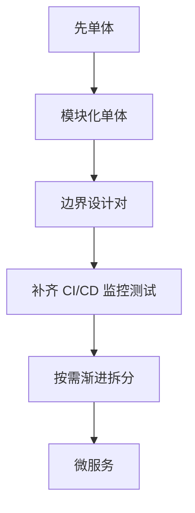

## 定义与本质区别

微服务是一种**架构风格**：把一个单体应用拆分成若干**独立部署、独立演进、通过网络通信**的小服务，每个服务围绕**业务能力**（而不是技术分层）划分，拥有自己的数据存储与发布节奏，服务之间通过轻量通信（通常是 HTTP/RPC 与消息队列）协作。

它与单体的本质区别不在"代码分成几块"，而在"能否独立部署与独立演进"。一个把 Controller/Service/DAO 分成三个模块的巨型单体仍然是单体；只有当三个部分能**各自打包、各自发布、各自扩容、各自有独立数据**时，才具备微服务的特征。

:::tip[判断标准]
**判断标准是部署单元边界，不是代码目录结构。**
:::

## 核心特征

| 特征 | 说明 |
|------|------|
| **按业务能力划分** | 不是按 Controller/Service/DAO 技术分层 |
| **独立部署** | 每个服务一个部署单元，可单独发版 |
| **独立数据** | 每个服务拥有自己的数据存储，不共享数据库 |
| **松耦合通信** | 服务间只通过接口契约交互 |
| **可观测与治理** | 统一日志、链路追踪、配置中心、服务发现 |

:::warning[注意]
**"独立数据"是微服务最容易被忽略、也最难回退的一条。**
:::

## 要解决的问题

微服务要解决的是"组织与交付效率"。当单体膨胀到几十个团队共改一个仓库、每次发版要回归全量、某个热点模块被迫与整个系统一起扩容时，微服务把**耦合点从编译期移到运行期**，从而让不同团队能并行开发、独立发布、独立扩容。

:::note
**它优化的是协作与交付，不是性能。**
:::

## 适用场景

### 什么时候该用

| 条件 | 说明 |
|------|------|
| **团队规模需要独立交付** | 多团队共改单体，每次发版互相阻塞 |
| **伸缩需求差异巨大** | 某模块 IO 密集需大量实例，另一模块计算密集 |
| **业务边界清晰** | 能划分出边界明确、职责单一的领域 |
| **独立发布节奏诉求** | 某些模块需要高频迭代、另一些追求稳定 |
| **具备分布式运维能力** | 有 CI/CD、服务治理、监控、故障处理的基础设施与人才 |

### 什么时候不该用

| 条件 | 说明 |
|------|------|
| **团队很小或人员不成熟** | 3~10 人的团队做微服务，运维成本会压垮收益 |
| **业务边界还不清晰** | 边界没理清就拆，只会造出"分布式单体" |
| **规模还小** | 单体足以支撑当前业务量 |
| **缺少基础设施** | 没有 CI/CD、监控、链路追踪、容器编排，拆开只会更糟 |
| **强事务一致性要求很高** | 跨服务强一致需要分布式事务，复杂度陡增 |

## 失败模式与拆分原则

### 最常见的失败模式：分布式单体

:::caution[分布式单体]
这是微服务实践中最普遍的翻车形态：服务拆开了，但**接口之间调用密集、数据仍共享同一套库、发布仍需协调**，结果是**同时承担了分布式的复杂度和单体的耦合**——比单体更糟。根因是**拆分维度错了**（按技术分层拆，或按"太难写所以拆出去"拆），而不是按业务能力拆。
:::

### 拆分的关键

拆分的关键是"按业务能力 + 限界上下文"。理想的服务边界应当是**业务上内聚、技术上自治**的。

:::tip[边界是否合理的实用标准]
- 这个服务能否在不与其他服务协商的情况下独立演进、独立发版
- 能否独立地决定自己的数据模型
:::

## 代价与务实路径

### 必须付出的代价

| 代价 | 说明 |
|------|------|
| **分布式复杂度** | 网络不可靠、部分失败、分布式事务、最终一致、时钟不一致、幂等 |
| **可观测性成本上升** | 一次请求跨 N 个服务，没有链路追踪根本排查不了 |
| **测试成本上升** | 要测服务间契约、要做集成测试与契约测试 |
| **部署运维复杂度** | 几十个服务要独立发布、滚动升级、灰度、回滚 |
| **延迟累加** | 网络跳数增加 |

:::warning[这些是必须付的代价，不是可以忽略的细节。]
:::

### 一条务实的路径建议

**先单体，把边界设计对**——在单体内部用清晰的模块边界与接口契约（保证未来能拆），同时补齐 CI/CD、监控与自动化测试。**当某个边界真的需要独立部署/扩容时再拆**，拆一个拆一个（**渐进式 strangler fig 模式**），而不是一次拆成二十个。

:::note[正确起点]
**模块化单体（Modular Monolith）是绝大多数团队的正确起点。**
:::

## 面试怎么答

1. **三段式结构**：定义与本质区别 → 适用场景 → 代价与教训
2. **定义与本质区别**：边界在部署单元与数据所有权，不在代码目录
3. **什么时候用**：团队规模、伸缩需求差异、发布节奏、组织能力
4. **什么时候不该用**：团队小、边界不清、缺基础设施
5. **代价与教训**：分布式复杂度 + 最常见的"分布式单体"失败模式 + 模块化单体起步、渐进拆分

:::tip[区分层次的关键]
第三段是区分层次的关键——只会背定义和优缺点的人很多，能说出"分布式单体"和"模块化单体起步"的才显示是做过的人。
:::
