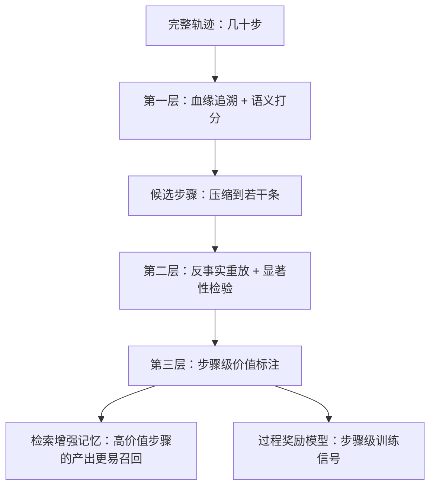

长程任务的信用分配要拆成两个子问题：先用便宜的多种信号把候选步骤筛出来，再对候选步骤做反事实干预的因果验证，结论要做成步骤级的分类而不是一个笼统的分数。难点在于奖励稀疏——成功与否往往在几十步之后才显现，中间每一步既没有独立标签，贡献又与后续步骤高度耦合。

## 难点：奖励稀疏，步骤之间强耦合

长程任务的奖励是稀疏的，成功与否往往在几十步之后才显现，而中间每一步既没有独立标签，贡献又与后续步骤高度耦合。删掉一步往往会让整条轨迹无法按原路径复现（后续动作依赖这一步的观测），所以"这一步到底有没有用"很难直接判定。

- 没有步骤级标签：只有终局对错，中间步骤拿不到监督信号。
- 相关与因果混在一起：某一步"看起来被用到"，不等于"去掉它任务就会失败"。
- 重跑昂贵且带噪声：反事实实验本身的方差可能盖过真实效应。
- 一步错会连锁：失败轨迹常常不是少做了某一步，而是被某个错误步骤污染后一路传下去。

所以工程上的解法不是追求单点精确，而是先低成本地把候选步骤筛出来，再对少数候选花大成本做验证。

## 第一层筛选：三类便宜信号

候选筛选要用多路便宜的信号，每路只做它擅长的那部分判断，谁便宜谁先上。

| 信号 | 做法 | 成本 | 可信度 | 用途 |
| --- | --- | --- | --- | --- |
| 血缘追溯 | 检查这一步输出里的关键事实（数值、实体、结论）是否被下游步骤或最终答案引用 | 极低，只解析轨迹结构 | 高，属于结构性证据 | 可直接计入有贡献 |
| 语义打分 | 用一个独立的评估模型判断这一步相对于最终答案的相关性 | 低 | 中低，容易被表面相似骗过 | 只用于排序，不能定论 |
| 失败对照 | 比较同一个任务在不同运行中失败轨迹与成功轨迹的差异 | 中，需要多条轨迹 | 中 | 剔除只出现在失败轨迹里的噪声步骤 |

血缘追溯是最划算的一路：如果某个数值、实体或者结论确实出现在最终答案里，那么产出它的那一步大概率有贡献。语义打分便宜但不可靠，只能用来排序而不能用来定论。失败对照的判断依据是稳定性：被稳定执行且最终成功的步骤更可能必要，而只在失败轨迹中出现的步骤往往是噪声。

## 第二层验证：反事实干预

判定某一步是否有贡献，最直接的方法是把这一步从轨迹中移除，或者把它的观测替换成无害内容，然后从该步之后的某个检查点开始重新执行，比较最终结果的差异。差异显著说明这一步有因果贡献，没有显著差异则说明它可能是冗余的。

| 干预方式 | 操作 | 反映什么 |
| --- | --- | --- |
| 删除干预 | 移除该步，从其后的检查点重放 | 检验必要性，移除后任务失败即为必要步骤 |
| 替换干预 | 把该步观测换成无害内容（空结果、占位符） | 保留步数结构，只切掉这一步携带的信息 |
| 注入扰动 | 在该步写入错误或噪声，观察下游退化幅度 | 该步骤在轨迹里的承重能力 |

这套方法的困难在于重跑昂贵且结果带噪声，所以工程上要做三件事：

1. 固定采样和固定随机种子，尽可能保证实验可复现。
2. 对每一步做多次重复取均值，并用自助法（bootstrap）给出置信区间，而不是只看单次差异。
3. 利用轨迹的依赖图，只重放受影响的分支，而不是把整条轨迹重新跑一遍。

## 贡献度分四类，不要打成一个总分

判定某一步是否有贡献时，结论应该明确区分四种情况，因为四种情况对应四种完全不同的处理动作。

1. 必要步骤：移除后任务会失败，属于有贡献的必要步骤，必须保留。
2. 正贡献步骤：其结果被下游有效使用并带来了成功率提升，去掉不一定失败但会更难。
3. 冗余步骤：移除后结果不变，说明它可以省掉，换成成本和延迟上的收益。
4. 负贡献步骤：引入了错误或者噪音，导致了额外的修复成本和错误传播，需要优先修掉。

第四类尤其重要，因为很多轨迹的失败并不是缺少步骤，而是被某个错误步骤污染之后的连锁反应，识别出负贡献步骤的价值往往比找到正贡献步骤更大。所以归因结果要按类型沉淀，不能压成一个总分——总分既不告诉你该删谁，也不告诉你该修谁。

## 训练侧：用过程奖励模型补上稀疏反馈

在强化学习框架里，信用分配的落点是过程奖励模型，也就是学习一个能对每个中间步骤打分的价值模型，把稀疏的终局奖励变成密集的步骤级奖励，从而让策略更新有可归因的信号。步骤级归因结论正好是它的训练数据来源，这也是归因要沉淀成结构化标注、而不是一份只给人看的报告的原因。

这里最大的陷阱是奖励代理被模型钻空子（reward hacking）：过程奖励看起来变高了，真实任务成功率却没有提升。防它至少要做两件事：

- 保留一份不参与训练的终局指标，定期校验，只认它是否随训练同步上涨。
- 对奖励模型本身做分布漂移监控，输入分布一变，打分口径就已经失真。

## 落地：三层漏斗与全链路可重放

整体落地方案是一个分层漏斗，成本从低到高、置信度也从低到高，每一层的输出是下一层的输入。

第一层用血缘追溯和语义打分把几十步压缩到若干候选，第二层对候选做反事实重放并做统计显著性检验，第三层把结论沉淀成步骤级的价值标注，既用于后续的检索增强记忆，让高价值步骤的产出更容易被召回，也用于训练过程奖励模型。

整个过程还要保证全链路可重放：记录每一步的状态、动作、观测、耗时与产出，让任何一次归因结论都能回溯到具体的证据——哪次重放、哪个置信区间、哪条下游引用。否则线上复盘时既说不清结论怎么来的，也没法被质疑和推翻。

## 常见追问：口径与边界

- **问：某一步的输出被最终答案引用了，能不能直接断定它有贡献？** 不能。血缘只能证明"被使用"，不能证明"必须有"，它是最便宜的排序信号，最终结论要靠反事实重放。
- **问：反事实重放那么贵，几十步的轨迹怎么做得起？** 靠两层压缩：第一层先把几十步压到若干候选，重放时只走依赖图里受影响的分支，并对每步多次重复取均值加置信区间，而不是整条轨迹逐帧重跑。
- **问：为什么一定要分类，给每步打个分数不行吗？** 分数没有决策区分度：必要步骤和"有用但可替代"的步骤都会得高分，你没法据此决定该删谁、该修谁。四类标注直接对应四种动作。
- **问：过程奖励模型为什么不能只看它自己的分数？** 因为它和策略一起优化，会被钻空子。必须有留出的终局指标当锚，再叠加对奖励模型的分布漂移监控。

## 易错点：把相关当成因果

- 把语义相关性当成因果贡献。语义打分只是便宜的排序手段，用它定论必然把"看起来相关"的冗余步骤算成有贡献。
- 只做一次重放就下结论。重放本身带噪声，单次差异可能来自采样抖动，至少要多次重复取均值并给出置信区间。
- 只看正贡献、忽略负贡献。轨迹失败常是错误步骤污染后的连锁反应，不单独标注负贡献步骤，就会一直在"补步骤"而不是"修污染"。
- 用过程奖励的上涨当作成功证据。奖励被钻空子时它恰恰先涨起来，真实成功率反而停滞，必须用不参与训练的终局指标校准。

## 一句话记住

:::tip
先筛后验：便宜信号排序，反事实干预定论，贡献分类不打分。
:::
